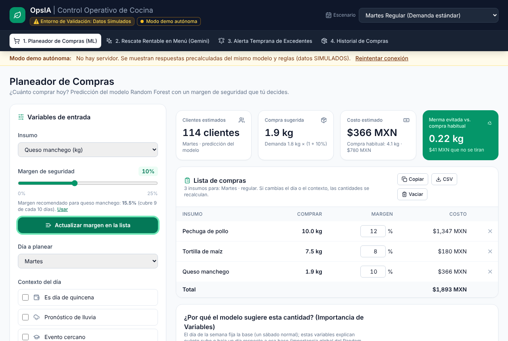
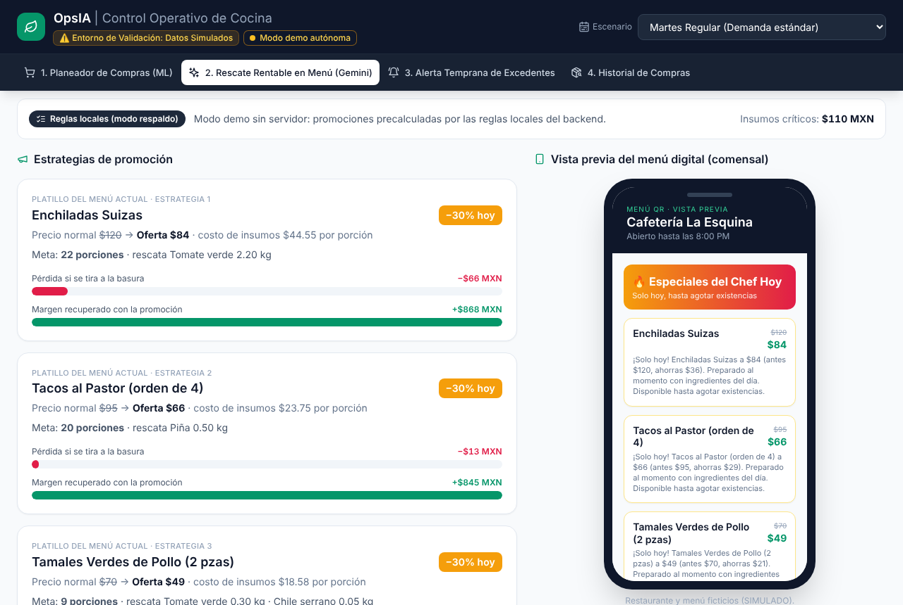
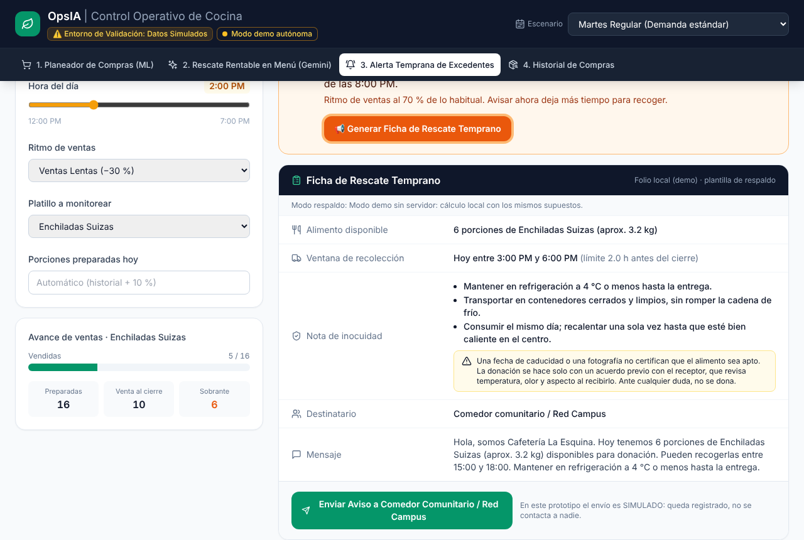
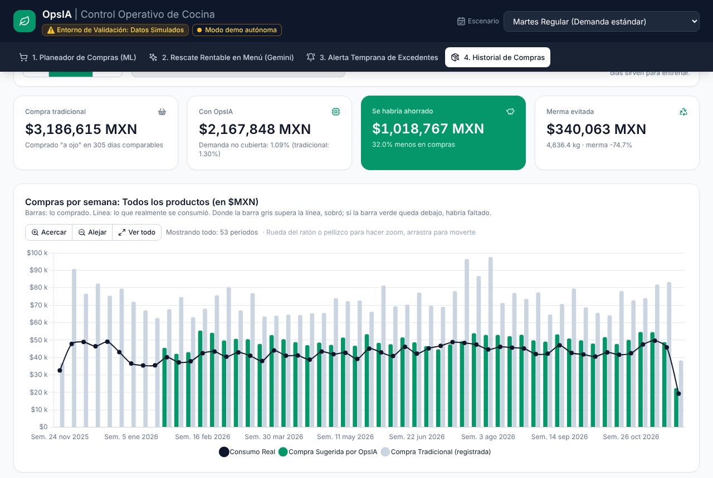

# OpsIA

*Nombre inspirado en Ops, diosa romana de la abundancia y las cosechas y en la implementación de la IA.*

**El problema:** los restaurantes compran sus insumos perecederos "a ojo". Si compran de más, la comida caduca y se tira; si recortan al tanteo, se quedan sin platillos. **OpsIA** predice cuánto comprar de cada insumo (Machine Learning), propone promociones rentables para vender lo que está por caducar (Google Gemini) y avisa a tiempo a comedores comunitarios cuando va a sobrar comida.

> ⚠️ Todos los datos del restaurante son **SIMULADOS** (prototipo de validación).

**Reto:** Reto 1 · Segunda Mesa — *¿Cómo podríamos lograr que el alimento que hoy se tira llegue, a tiempo y sin fricción, a quien sí puede aprovecharlo?*

## Evidencia del problema

- En 2022 se desperdiciaron **1,050 millones de toneladas** de alimentos en el mundo; los **servicios de comida** generaron **≈ 28 %** (290 millones de t). Fuente: PNUMA, [*Food Waste Index Report 2024*](https://www.unep.org/resources/publication/food-waste-index-report-2024).
- En México se desperdician alrededor de **20.4 millones de toneladas al año**, cifra atribuida a la FAO ([Expansión, 30/09/2025](https://politica.expansion.mx/mexico/2025/09/30/fao-mexico-desperdicia-cada-ano-20-4-millones-de-toneladas-de-alimentos)).

## Usuarios

Encargado de compras, cocina y gerente de turno, comensales, comedores comunitarios que reciben el excedente y el dueño. Los identificamos siguiendo el recorrido del alimento (quién compra, quién ve que sobra, quién puede aprovecharlo) y con la evidencia anterior. **No hicimos entrevistas todavía**: los usuarios son hipótesis que el piloto debe confirmar ([detalle](docs/00_resumen_proyecto.md#cómo-identificamos-a-los-usuarios)).

## Solución y flujo

1. **Planeador de compras** (mañana): un Random Forest predice el consumo y sugiere cuánto comprar con un margen de seguridad.
2. **Rescate en menú** (mediodía): Gemini propone promociones rentables con los insumos que caducan en menos de 24 h.
3. **Alerta temprana** (tarde): si va a sobrar comida, genera una ficha para que un comedor comunitario la recoja a tiempo.
4. **Historial de compras**: compara lo comprado "a ojo" contra lo que habría sugerido OpsIA.

Antes de elegirla comparamos otras 4 alternativas (app de excedentes, Excel, sensores, solo donar) y explicamos por qué las descartamos en el [resumen del proyecto](docs/00_resumen_proyecto.md#alternativas-que-consideramos).

> **Inocuidad:** una fecha de caducidad o una foto **no certifican** que un alimento sea apto. La ficha lo advierte y la donación requiere un acuerdo previo con el receptor, que revisa el alimento al recibirlo.

## Tecnologías

| Tecnología | Por qué |
|---|---|
| Python + FastAPI | API rápida de escribir, con validación automática (Pydantic) y documentación en `/docs`. |
| SQLite | Una sola base en un archivo, sin instalar servidor; cada registro marca si es SIMULADO o REAL. |
| scikit-learn (Random Forest) | Funciona bien con pocos datos y variables de calendario, y explica qué variables pesan más. |
| Google Gemini | Redacta promociones y avisos con salida JSON validada; si falla, hay un modo respaldo con reglas locales. |
| HTML + Tailwind + JavaScript + Chart.js | Sin compilar nada; también abre sin servidor (modo demo). |

## Capturas

| Planeador de compras | Rescate en menú |
|---|---|
|  |  |
| **Alerta temprana** | **Historial de compras** |
|  |  |

Capturas tomadas en modo demo (sin servidor ni llave de Gemini), con datos SIMULADOS.

## Ejecutar

Requiere Python 3.10 o superior.

```bash
git clone https://github.com/AndreRodriguez06/Hackateate_2026.git
cd Hackateate_2026
pip install -r requirements.txt
py data/generar_datos.py && py -m uvicorn backend.main:app --reload
```

Abrir **<http://localhost:8000>**. La primera vez el servidor genera los datos simulados y entrena el modelo (≈ 10 s).

Sin instalar nada: doble clic en `frontend/index.html` abre la aplicación en **modo demo** (sin servidor).

## Llave de Gemini (opcional)

1. Crea una llave en [Google AI Studio](https://aistudio.google.com/apikey).
2. Copia la plantilla: `cp .env.example .env` (Windows: `copy .env.example .env`).
3. En `.env` cambia `tu_api_key_aqui` por tu llave y reinicia el servidor.

Sin llave todo funciona igual: las promociones y avisos se calculan con reglas locales y la pantalla dice **"modo respaldo"**. El archivo `.env` no se sube a git.


## Qué es simulado

El restaurante, su menú, su historial de ventas, su inventario y sus precios son **SIMULADOS** (cada registro lo dice en la columna `origen_dato`). Son reales el código, el modelo, la integración con Gemini y las cifras de contexto con fuente. Detalle en la [declaración de simulaciones](docs/00_resumen_proyecto.md#4-declaración-de-simulaciones).

## Limitaciones y próximos pasos

- Sin entrevistas ni validación con usuarios reales; los resultados del modelo provienen de datos simulados.
- Precios de insumos provisionales (falta sustituirlos por los de PROFECO).
- El envío de avisos a comedores es simulado (no hay WhatsApp ni correo).
- Próximo paso: entrevistar a 3–5 encargados de compras, pesar la merma real 4 semanas y hacer un piloto de 14 días. Lista completa en el [resumen](docs/00_resumen_proyecto.md#8-limitaciones-actuales).

## Plan de negocios y fuentes

[`docs/08_plan_negocios.md`](docs/08_plan_negocios.md): fuentes verificables, supuestos marcados, competencia, costos (incluye capacitación, coordinación y transporte) y punto de equilibrio.

## Equipo

| Integrante | Rol | GitHub |
|---|---|---|
| Andre | _por completar_ | [@AndreRodriguez06](https://github.com/AndreRodriguez06) |
| César | _por completar_ | [@CesarE-gith](https://github.com/CesarE-gith) |
| Diego | _por completar_ | [@DiegoHR14](https://github.com/DiegoHR14) |
| Isaac | _por completar_ | _por completar_ |
| Alan | _por completar_ | _por completar_ |

---

Documentación completa (problema, evidencia, modelo, API, plan de negocios y pruebas): [`docs/00_resumen_proyecto.md`](docs/00_resumen_proyecto.md).
