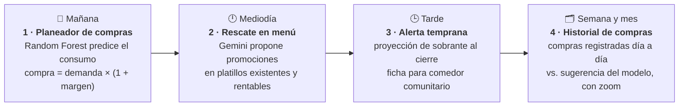
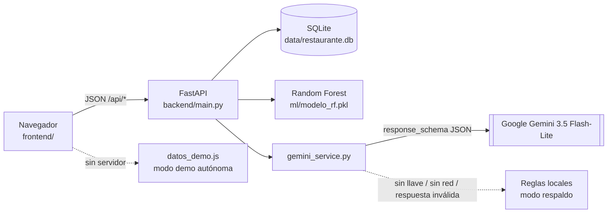

# Resumen completo del proyecto OpsIA

> Versión extendida del README (problema, usuarios, evidencia, tecnologías, declaración de simulaciones, resultados, equipo, limitaciones y próximos pasos). El [README](../README.md) de la raíz es la guía breve para ejecutar.

**Control operativo de cocina para reducir la merma de alimentos en restaurantes.** OpsIA predice cuánto comprar de cada insumo con Machine Learning, propone promociones rentables con Google Gemini para vender lo que está por caducar y avisa a tiempo a comedores comunitarios cuando va a sobrar comida.

> ⚠️ **Entorno de validación: todos los datos son SIMULADOS.** El restaurante, su historial, su inventario y sus precios son ficticios. La sección [Declaración de simulaciones](#declaración-de-simulaciones) detalla qué es simulado y dónde empieza la simulación.

---

## 1. El reto

**Pregunta del reto (Guía del Reto):** ¿Cómo podríamos lograr que el alimento que hoy se tira llegue, a tiempo y sin fricción, a quien sí puede aprovecharlo?

**Nuestra versión acotada:** ¿cómo puede un restaurante de plaza comercial comprar solo lo que va a usar y, si aun así le sobra, vender o donar a tiempo ese alimento sin quedarse sin platillos para sus clientes?

### Frase de delimitación

> En **restaurantes de comida casual de plazas comerciales en México**, el **encargado de compras** pierde **insumos perecederos (proteínas, lácteos, pan, verduras y platillos preparados)** cuando **compra "a ojo" sin anticipar los cambios de demanda por día de la semana, quincena, clima, días festivos o eventos de la plaza**, debido posiblemente a **que no tiene una herramienta que convierta su historial de ventas en una cantidad de compra**. Hoy lo resuelve mediante **su experiencia, listas en papel o Excel y, al cierre, tirando o regalando lo que sobra de manera informal**. Necesitamos comprobar **cuánto se tira realmente (en kg y $) y si el encargado confiaría en una sugerencia de compra automática**.

La frase es una **hipótesis**: se armó con la evidencia secundaria de la sección "Evidencia" y no con entrevistas propias (ver "Cómo identificamos a los usuarios").

### Problema delimitado

Un restaurante de plaza comercial en México (caso hipotético) compra sus insumos perecederos **por intuición**: el encargado repite lo del día más fuerte de la semana anterior, con un colchón "por si acaso". El resultado es un ciclo de dos fallas:

- **Sobreinventario:** compra de más, y el pollo, la crema o la tortilla caducan en el almacén y se tiran.
- **Desabasto:** cuando intenta recortar "al tanteo", se queda sin platillos en hora pico.

El problema se delimita a: **un restaurante**, **insumos perecederos**, **decisiones diarias** (compra de la mañana, venta durante el día, sobrante al cierre) y **platillos que ya existen en su menú**. No se aborda la cadena de suministro ni el desperdicio en hogares.

### Usuarios objetivo

| Usuario | Qué necesita | Vista de OpsIA |
|---|---|---|
| **Encargado de compras** | Saber cuánto comprar hoy sin tirar ni quedarse corto | 1 · Planeador de compras |
| **Personal de cocina y gerente de turno** | Vender hoy lo que está por caducar; saber a media jornada si sobrará comida | 2 · Rescate en menú · 3 · Alerta temprana |
| **Comensales** | Ofertas atractivas en platillos que ya conocen | Menú digital QR (vista previa en la Vista 2) |
| **Receptores: comedores comunitarios y red estudiantil** | Avisos con tiempo, cantidad exacta y cuidados de inocuidad | Ficha de rescate (Vista 3) |
| **Dueño** | Evidencia del ahorro | 4 · Historial de compras |

### Cómo identificamos a los usuarios

- **Recorriendo el flujo del alimento** de la pregunta del reto: quién decide cuánto se compra (encargado de compras), quién ve que algo va a sobrar (cocina y gerente de turno), quién puede aprovecharlo (comensales con una promoción y, al final, un comedor comunitario) y quién paga (dueño).
- **Con la evidencia secundaria:** los servicios de comida generan cerca de 28 % del desperdicio de alimentos en el último eslabón (PNUMA, tabla siguiente), y la mayoría de los restaurantes pequeños compra sin pronóstico (las alternativas actuales son Excel o un punto de venta con inventario, ver `docs/08`, sección 3).
- **Lo que falta:** **no hicimos entrevistas ni observación en restaurantes reales.** Los usuarios y sus necesidades son supuestos de trabajo. El primer paso del piloto (sección 9) es entrevistar a 3–5 encargados y observar un cierre de cocina para confirmarlos o corregirlos.

### Evidencia que sustenta el problema

| Dato | Fuente |
|---|---|
| En 2022 se desperdiciaron **1,050 millones de toneladas** de alimentos en el mundo, casi una quinta parte de los alimentos disponibles para los consumidores. | PNUMA (UNEP), *Food Waste Index Report 2024* — [publicación](https://www.unep.org/resources/publication/food-waste-index-report-2024) · [mensajes clave (PDF)](https://wedocs.unep.org/bitstream/handle/20.500.11822/45275/Food-Waste-Index-2024-key-messages.pdf?sequence=8) |
| De ese total, los **servicios de comida** (restaurantes, cafeterías, comedores) generaron **290 millones de toneladas (≈ 28 %)**: unos 36 kg por persona al año. Los hogares, 60 %; el comercio minorista, 12 %. | PNUMA, *Food Waste Index Report 2024*, mismas fuentes |
| En México se desperdician alrededor de **20.4 millones de toneladas de alimentos al año**, cerca de un tercio de la producción nacional. | Cifra atribuida a la FAO en prensa: [Expansión, 30/09/2025](https://politica.expansion.mx/mexico/2025/09/30/fao-mexico-desperdicia-cada-ano-20-4-millones-de-toneladas-de-alimentos). Otras estimaciones nacionales van de 12.5 a 31 millones de toneladas según metodología y año. |

> El desperdicio del caso (kilos y pesos que aparecen en la aplicación) es **SIMULADO**. Las cifras de esta tabla son reales y sirven de contexto, no como datos del restaurante.

---

## 2. La solución y su flujo principal

OpsIA acompaña los momentos en que se decide la merma, del día a día al cierre de mes:





Lo más importante del diseño:
- **Python hace las cuentas y la IA decide y redacta.** El backend calcula los descuentos rentables, las ventanas de recolección y las porciones, y valida todo lo que propone Gemini. Gemini no puede inventar platillos ni vender por debajo de 1.5 veces el costo.
- **La demo nunca se cae.** Sin llave de Gemini funciona en modo respaldo; sin servidor, el frontend usa respuestas precalculadas. Ambos modos se indican en pantalla.
- **Anti-desabasto:** alerta si el margen baja de 4 %, y un margen recomendado por insumo calculado con los errores reales del modelo.

### Alternativas que consideramos

| Alternativa | Qué haría | Por qué la descartamos o la acotamos |
|---|---|---|
| **A. App para vender excedentes al público** (estilo Cheaf o Too Good To Go) | Publicar al final del día lo que sobró, con descuento | Ya existe y ataca el síntoma: el alimento ya se compró de más. No reduce la compra excesiva, que es donde empieza la merma. |
| **B. Plantilla de Excel con promedios** | Promedio de consumo por día de la semana para decidir la compra | Barata y fácil, pero no considera quincena, lluvia, días festivos ni eventos, y depende de que alguien la actualice. La usamos como **línea base** para comparar el modelo. |
| **C. Básculas o sensores en el almacén** (IoT) | Medir el inventario y la merma de forma automática | Costo de hardware e instalación alto para un restaurante pequeño y no dice cuánto comprar. Puede sumarse después para medir la merma real. |
| **D. Solo avisar a comedores comunitarios** | Donar lo que sobra al cierre | Necesaria, pero llega tarde: al cierre ya no hay tiempo para una recolección segura. La integramos como último paso, con aviso a media jornada. |
| ✅ **Elegida: OpsIA** | Predicción de compra + rescate en menú + aviso temprano al comedor + historial | Previene la merma **antes de comprar**; si aun así sobra, la vende con una promoción y, si no se vende, la redirige a tiempo. Solo necesita el historial de ventas que el restaurante ya tiene. |

### Por qué cada tecnología

| Tecnología | Para qué | Por qué la elegimos |
|---|---|---|
| **SQLite** | Base de datos | Un archivo, sin servidor ni instalación; viene con Python. Suficiente para un restaurante; la columna `origen_dato` con `CHECK` obliga a etiquetar cada registro. |
| **scikit-learn · Random Forest** | Predicción de demanda | Funciona bien con pocos datos tabulares, encuentra combinaciones entre variables sin programarlas a mano (lluvia en fin de semana), no predice cantidades negativas y explica qué variables pesaron (`feature_importances_`). Se compara en cada entrenamiento contra una regresión lineal y un promedio. |
| **FastAPI + Pydantic** | API REST y servidor del frontend | Valida entradas automáticamente, genera documentación interactiva en `/docs` y sirve la API y la página en un solo comando. |
| **HTML + Tailwind CSS + Chart.js + Lucide (CDN)** | Interfaz | Sin compilación ni Node.js: se abre con doble clic. Responsiva para usarse desde el celular en el almacén. |
| **Google Gemini 3.5 Flash-Lite (`google-genai`)** | Promociones y fichas de rescate | Rápido y económico para tareas cortas. Con *Structured Outputs* (`response_schema` Pydantic) responde JSON con esquema fijo: no es un chatbot. |

---

## 3. Instalación y ejecución en 3 pasos

**Requisitos:** Python 3.10 a 3.13, Git y conexión a internet (para instalar paquetes y cargar las librerías del frontend desde CDN).

```bash
# 1. Clonar
git clone https://github.com/AndreRodriguez06/Hackateate_2026.git
cd Hackateate_2026

# 2. Instalar dependencias (recomendado dentro de un entorno virtual, ver abajo)
pip install -r requirements.txt

# 3. Generar los datos SIMULADOS y arrancar
python data/generar_datos.py && uvicorn backend.main:app --reload
```

Abrir **<http://localhost:8000>** (aplicación) y **<http://localhost:8000/docs>** (documentación interactiva de la API).

<details>
<summary><b>Entorno virtual, Windows y otras formas de arrancar</b></summary>

Entorno virtual (recomendado, para no mezclar versiones):

```bash
python -m venv .venv
source .venv/bin/activate          # Windows: .venv\Scripts\activate
pip install -r requirements.txt
```

- En **Windows PowerShell 5**, `&&` no funciona: ejecuta `python data/generar_datos.py` y después `uvicorn backend.main:app --reload`.
- Alternativa al paso 3: `python backend/main.py`. Si falta la base o el modelo, el servidor los genera y entrena solo (≈ 6 s).
- **Sin instalar nada:** doble clic en `frontend/index.html` abre la aplicación en **modo demo autónoma**, con respuestas precalculadas del mismo modelo.
- Si `uvicorn` no se reconoce como comando: `python -m uvicorn backend.main:app --reload`.
</details>

### Activar Gemini (opcional)

```bash
cp .env.example .env               # Windows: copy .env.example .env
```

Edita `.env` y cambia `tu_api_key_aqui` por tu llave de [Google AI Studio](https://aistudio.google.com/apikey). Reinicia el servidor. `.env` **no se sube a git**. Sin llave, todo funciona en **modo respaldo** y la interfaz lo indica.

Para comprobar que Gemini funciona: `python backend/gemini_service.py`. Debe mostrar `"modo_respaldo": false`.

### Verificar que todo funciona

```bash
python -m unittest discover -s tests -v    # 66 pruebas automáticas (datos, modelo, API, Gemini)
python scripts/prueba_humo.py              # 8 casos de punta a punta, con el servidor encendido
```

### Ver la base de datos y simular datos distintos

```bash
python scripts/exportar_csv.py             # exporta todas las tablas a data/csv/ (se abren en Excel)
python data/generar_datos.py --semilla 7   # otro restaurante simulado; el servidor reentrena el modelo solo
```

---

## 4. Declaración de simulaciones

**Dónde empieza la simulación:** en [`data/generar_datos.py`](../data/generar_datos.py). Ese script inventa, con reglas documentadas y una semilla fija, el restaurante y sus 365 días de historia. **Todo lo que sale de la base `data/restaurante.db` es SIMULADO.** Cada tabla tiene la columna `origen_dato`, que la base solo acepta como `'SIMULADO'` o `'REAL'`, y cada respuesta de la API incluye `es_simulado`.

| Parte del sistema | ¿Simulado? | Detalle |
|---|---|---|
| Restaurante "Cafetería La Esquina", menú de 30 platillos y recetario | **SIMULADO** | Ficticios; porciones típicas de cocina mexicana. |
| Historial de 365 días: afluencia, clima, quincena, días festivos, época del año, eventos cercanos y en la plaza, ventas, consumo | **SIMULADO** | Reglas en `docs/02_base_de_datos.md`. |
| Compra tradicional "a ojo" y su merma | **SIMULADO** | Es la línea base contra la que se compara. |
| Inventario con caducidades | **SIMULADO** | Relativo a la hora en que se genera, para que siempre haya insumos críticos. |
| Precios de los 46 insumos | **SIMULADO (provisional)** | Pendiente sustituir por PROFECO *Quién es Quién en los Precios*; la columna `fuente_precio` lo indica. |
| Supuestos de negocio: elasticidad del descuento, precio ≥ 1.5 × costo, curva de ventas por hora, horario 09:00–20:00, ventana de 2 h | **SIMULADO** | Constantes en `backend/services/` y `backend/gemini_service.py`. |
| Envío del aviso al comedor comunitario | **SIMULADO** | Solo se registra en la base; no se contacta a nadie. |
| Modo demo autónoma (`frontend/datos_demo.js`) | Respuestas reales del sistema sobre datos **SIMULADOS** | Generado con `scripts/exportar_datos_demo.py`. |
| Algoritmos, modelo Random Forest, validación temporal, API, interfaz | **REAL** | Código funcional que se puede usar con datos reales. |
| Llamadas a Gemini (con llave) | **REAL** | Modelo real que trabaja sobre datos SIMULADOS. |
| Cifras de contexto (PNUMA, FAO) | **REAL** | Con su fuente en la sección 1. |

---

## 5. Resultados sobre datos simulados

Corrida del 2026-11-26. Las cifras cambian ligeramente si se regeneran los datos otro día.

| Indicador | Resultado | Detalle |
|---|---|---|
| Error del modelo en el mes de prueba (nunca visto) | MAE 13.9 comensales (R² 0.83); error medio por insumo 11.0 %. La regresión lineal *one-hot* es mejor en estos datos simulados (9.7 %) y lo reportamos | [`docs/03_modelo_ml.md`](03_modelo_ml.md) |
| Mes de prueba con margen recomendado vs. compra tradicional | −34 % de compra, −82 % de sobrante, demanda no cubierta 0.96 % vs. 1.51 % | ídem |
| Historial completo, 305 días comparables (46 insumos) | $915 mil menos en compras (−29.8 %), merma −72.4 %, demanda no cubierta 0.98 % vs. 1.00 % | [`docs/04_backend_api.md`](04_backend_api.md) |
| Rescate en menú (ejemplo) | 3 promociones rentables sobre $1,891 MXN de insumos críticos | [`docs/06_integracion_gemini.md`](06_integracion_gemini.md) |

> Son resultados de un método real sobre datos **SIMULADOS**: demuestran que el sistema funciona, no prometen ese ahorro en un restaurante real.

---

## 6. Estructura del repositorio

```text
Hackateate_2026/
├── README.md · requirements.txt · .env.example
├── data/        schema.sql · generar_datos.py  →  restaurante.db (se genera)
├── ml/          modelo_demanda.py               →  modelo_rf.pkl (se genera)
├── backend/     main.py · database.py · gemini_service.py · services/ (rescate_menu, alerta_excedente, historial_compras)
├── frontend/    index.html · app.js · datos_demo.js
├── scripts/     exportar_datos_demo.py · exportar_csv.py · prueba_humo.py
├── tests/       66 pruebas automáticas (unittest)
└── docs/        documentación por apartado
```

## 7. Documentación

| # | Documento | Contenido |
|---|---|---|
| 01 | [`docs/01_arquitectura.md`](01_arquitectura.md) | Funciones del sistema, arquitectura, contratos de la API y flujo de las 4 vistas |
| 02 | [`docs/02_base_de_datos.md`](02_base_de_datos.md) | Esquema SQLite, generador de datos simulados, menú y recetario |
| 03 | [`docs/03_modelo_ml.md`](03_modelo_ml.md) | Random Forest, validación temporal, métricas y regla anti-desabasto |
| 04 | [`docs/04_backend_api.md`](04_backend_api.md) | Referencia de cada endpoint con ejemplos reales |
| 05 | [`docs/05_frontend_ux.md`](05_frontend_ux.md) | Interfaz, modo demo, decisiones de diseño y guion de la demo |
| 06 | [`docs/06_integracion_gemini.md`](06_integracion_gemini.md) | Esquemas JSON, prompts, validaciones y contingencias |
| 07 | [`docs/07_integracion_pruebas.md`](07_integracion_pruebas.md) | Bitácora de pruebas de punta a punta y checklist de entrega |
| 08 | [`docs/08_plan_negocios.md`](08_plan_negocios.md) | Plan de negocios: fuentes verificables, supuestos, competencia, costos, punto de equilibrio e impacto económico |
| 09 | [`docs/09_checklist_guia.md`](09_checklist_guia.md) | Checklist del proyecto contra la Guía del Reto: qué cumple y qué falta |

---

## 8. Limitaciones actuales

- **Sin investigación de campo:** no hicimos entrevistas ni observación en restaurantes ni comedores reales. La frase de delimitación y los usuarios son hipótesis basadas en evidencia secundaria.
- **Sin validación con usuarios:** nadie fuera del equipo ha usado el prototipo en una tarea real.
- **Inocuidad:** una fecha de caducidad o una fotografía **no certifican** que un alimento sea apto. La ficha de rescate lo advierte y pide un acuerdo previo con el receptor, pero el prototipo no verifica el estado del alimento.
- **Datos simulados:** el modelo aprendió reglas que nosotros definimos. Sus métricas prueban el método, no la precisión en un negocio real.
- **Precios provisionales:** aún no se sustituyen por precios consultados en PROFECO.
- **Gemini:** la integración está probada con respuestas simuladas y con la API real hasta la autenticación. Hay que confirmar con una llave válida que los textos generados sean adecuados. El modelo por defecto es `gemini-3.5-flash-lite` porque `gemini-2.5-flash` ya no se ofrece a proyectos nuevos.
- **Inventario simplificado:** cada día se evalúa por separado; el sobrante no pasa al día siguiente.
- **Supuestos de negocio no medidos:** el aumento de ventas por descuento y la curva de ventas por hora son supuestos.
- **Un solo restaurante, sin usuarios ni contraseñas**; pensado para correr localmente.
- **Envío de avisos simulado:** no hay integración con WhatsApp ni correo.
- **Librerías del frontend por CDN:** sin internet la página pierde estilos y gráficas (la lógica sigue funcionando).
- **Importancia de variables global:** explica el modelo en general, no cada predicción.

## 9. Próximos pasos para un piloto real

1. **Investigación de campo:** entrevistar a 3–5 encargados de compras y a 1–2 comedores comunitarios, y observar un cierre de cocina, separando lo observado, lo interpretado y lo supuesto.
2. **Línea base real:** pesar la merma de un restaurante durante 4 semanas antes de usar el sistema.
3. **Cargar datos reales:** exportar ventas e inventario del punto de venta (CSV), registrar con `origen_dato = 'REAL'` y reentrenar el modelo.
4. **Precios reales:** sustituir los precios por PROFECO *Quién es Quién en los Precios* y facturas del proveedor.
5. **Medir el valor de Gemini:** prueba A/B de promociones con texto de Gemini contra texto de plantilla.
6. **Avisos reales:** integrar WhatsApp Business o correo con un comedor comunitario aliado, con protocolo de inocuidad acordado.
7. **Operación:** usuarios y roles, despliegue en la nube, reentrenamiento semanal automático e inventario con arrastre entre días.
8. **Evaluar el piloto:** comparar merma, desabasto y margen contra la línea base del paso 2.

---

<sub>OpsIA · Prototipo para reto universitario · Todos los datos del restaurante son SIMULADOS.</sub>
