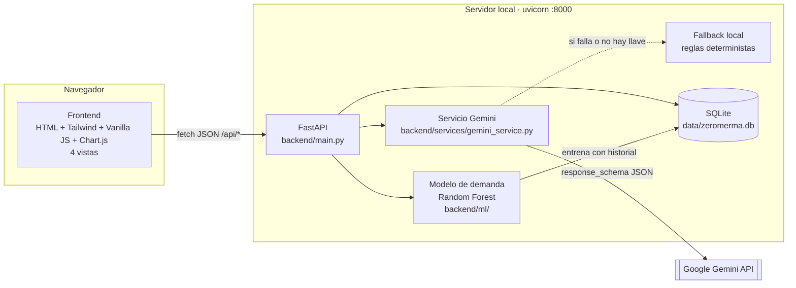
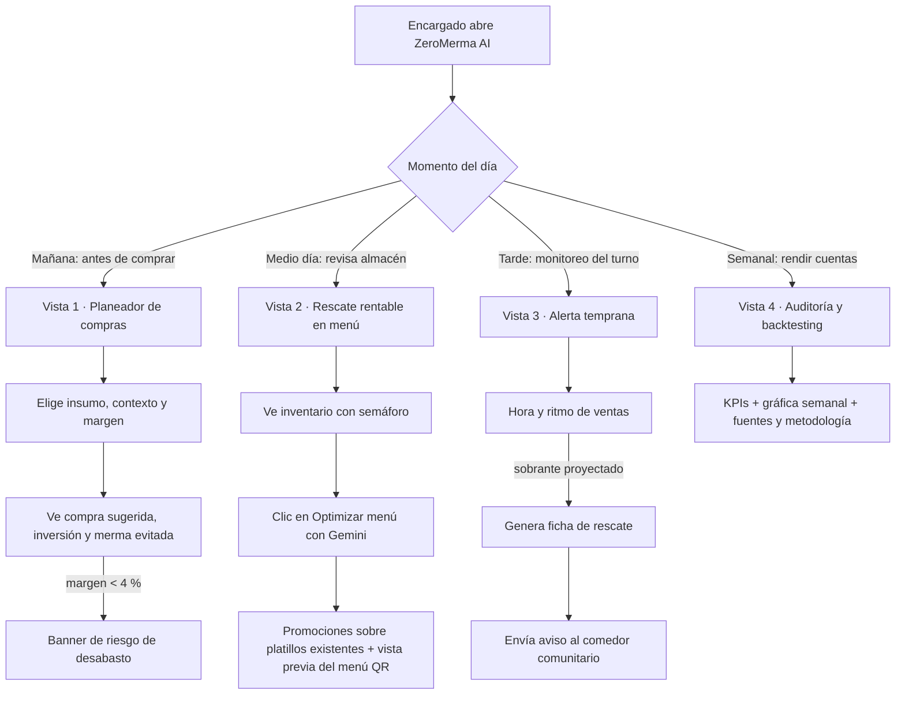
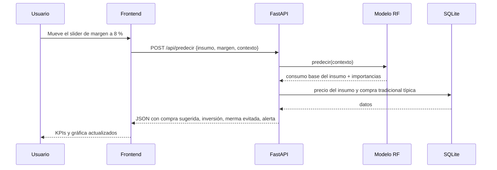

# 01 · Funciones del sistema y arquitectura

> **Apartado 1 · Orden 1.1** de la Tabla de Medios y Fines.
> Estado: ✅ definido. Los apartados siguientes construyen sobre este documento.

## 1. Objetivo

Definir **qué hace** ZeroMerma AI, **cómo se organiza** el código y **cómo se comunican** sus partes, antes de escribir el backend, el modelo y la integración con Gemini. Este documento es el contrato que siguen los 5 integrantes del equipo.

## 2. Problema y propuesta

Un restaurante de plaza comercial compra insumos perecederos **por intuición**. Si compra de más, el excedente caduca en almacén (merma). Si recorta al tanteo, se queda sin platillos en hora pico (desabasto o *stockout*).

ZeroMerma AI ataca el problema en tres momentos del día:

| Momento | Pregunta del encargado | Módulo | Tecnología |
|---|---|---|---|
| Antes de comprar (mañana) | ¿Cuánto compro hoy? | Planeador de compras | Random Forest (scikit-learn) |
| Durante el día | Tengo insumos por caducar, ¿cómo los vendo? | Rescate rentable en menú | Gemini con salida JSON |
| Antes del cierre | Me va a sobrar comida, ¿a quién aviso? | Alerta temprana de excedentes | Proyección de ventas + Gemini |

Y una cuarta vista demuestra el impacto: **Auditoría y backtesting**.

## 3. Funciones del sistema

### Requisitos funcionales

| ID | Función | Vista | Endpoint |
|---|---|---|---|
| RF-01 | Predecir los comensales del día a partir de calendario, clima, quincena y eventos. | 1 | `POST /api/predecir` |
| RF-02 | Calcular la compra sugerida por insumo: `predicción base × (1 + margen de seguridad)`. | 1 | `POST /api/predecir` |
| RF-03 | Permitir ajustar el margen de seguridad (0 % a 25 %) y recalcular al instante. | 1 | `POST /api/predecir` |
| RF-04 | Alertar riesgo de desabasto si el margen es menor a 4 %. | 1 | `POST /api/predecir` |
| RF-05 | Mostrar la importancia de variables del modelo (explicabilidad). | 1 | `POST /api/predecir` |
| RF-06 | Comparar la compra sugerida contra la compra tradicional: merma evitada en unidades y $MXN. | 1 | `POST /api/predecir` |
| RF-07 | Listar el inventario por lote con horas para caducar y semáforo (rojo < 24 h, ámbar < 72 h, verde). | 2 | `GET /api/inventario` |
| RF-08 | Cruzar insumos a menos de 24 h de caducar con el recetario y proponer promociones **solo sobre platillos existentes**. | 2 | `POST /api/optimizar-menu` |
| RF-09 | Calcular que cada promoción sea rentable: precio de oferta mayor que el costo de insumos por porción. | 2 | `POST /api/optimizar-menu` |
| RF-10 | Redactar el texto promocional para el menú digital del comensal. | 2 | `POST /api/optimizar-menu` |
| RF-11 | Proyectar porciones sobrantes al cierre según la hora y el ritmo de ventas. | 3 | `POST /api/alerta-excedente` |
| RF-12 | Generar una ficha de rescate (alimento, cantidad, ventana de recolección, nota de inocuidad). | 3 | `POST /api/alerta-excedente` |
| RF-13 | Comparar día a día compra tradicional, demanda real y compra sugerida (backtesting). | 4 | `GET /api/auditoria` |
| RF-14 | Mostrar en toda la interfaz que los datos son **SIMULADOS**. | Todas | Campo `origen_dato` en cada respuesta |
| RF-15 | Funcionar sin internet hacia Gemini: modo *fallback* con respuestas calculadas localmente. | 2 y 3 | Campo `modo` en la respuesta |

### Requisitos no funcionales

| ID | Requisito | Cómo se cumple |
|---|---|---|
| RNF-01 | Arrancar con un solo comando. | FastAPI sirve la API y los archivos del frontend en el mismo puerto. |
| RNF-02 | Instalación mínima. | Python 3.10+, `pip install -r requirements.txt`. Frontend sin build (CDN). |
| RNF-03 | Datos reproducibles. | El generador usa semilla fija (`--semilla 42`). |
| RNF-04 | Transparencia de datos. | Columna `origen_dato` con `CHECK` en cada tabla; badge en la UI; sección en `/docs`. |
| RNF-05 | Sin secretos en el repo. | La llave de Gemini va en `.env` (ignorado por git); se incluye `.env.example`. |
| RNF-06 | Tolerancia a fallos de la IA. | Si Gemini falla o no hay cuota, se usa el *fallback* y la UI lo indica. |
| RNF-07 | Responsivo. | Tailwind; probado en 390 px y 1440 px. |

## 4. Arquitectura

### Diagrama de componentes



### Decisión: monolito ligero

Un solo proceso FastAPI sirve la API, el modelo y el frontend. Para un sprint de 24 h, con 5 personas y una demo local, esto evita configurar CORS entre puertos, Docker o un servidor web aparte. CORS queda habilitado de todas formas, para quien quiera abrir el frontend desde otro puerto mientras lo desarrolla.

### Stack y justificación

| Capa | Tecnología | Por qué |
|---|---|---|
| Base de datos | SQLite (archivo) | Cero instalación; viene con Python; el archivo se regenera con un script. |
| Datos simulados | Python estándar (`random`, `sqlite3`) | Sin dependencias; reproducible con semilla. |
| Modelo | scikit-learn `RandomForestRegressor` | Funciona bien con pocos datos tabulares, captura interacciones (quincena × fin de semana) y trae `feature_importances_` para explicar. |
| Backend | FastAPI + uvicorn | Valida entradas con Pydantic, genera documentación automática en `/docs` y es fácil de leer. |
| IA generativa | Google Gemini con el SDK `google-genai` y `response_schema` | La respuesta llega como JSON con estructura fija, no como texto libre de chatbot. |
| Frontend | HTML5, Tailwind (CDN), Vanilla JS, Chart.js, Lucide | Sin build ni Node.js. Parte del prototipo `prueba1/`. |

## 5. Estructura de carpetas

Las rutas marcadas con ✅ ya existen. Las demás se crean en el apartado indicado.

```text
Hackateate_2026/
├── README.md                      ✅ (versión final en Apartado 7)
├── requirements.txt               Apartado 4
├── .env.example                   Apartado 6  (GEMINI_API_KEY=...)
├── .gitignore                     ✅
├── data/
│   ├── schema.sql                 ✅ Apartado 2 · esquema SQLite
│   ├── generar_datos.py           ✅ Apartado 2 · generador SIMULADO
│   └── zeromerma.db               (se genera; no se sube a git)
├── backend/
│   ├── main.py                    Apartado 4 · app FastAPI + estáticos
│   ├── database.py                Apartado 4 · conexión y consultas
│   ├── schemas.py                 Apartado 4 · modelos Pydantic (entrada/salida)
│   ├── ml/
│   │   ├── entrenar.py            Apartado 3 · entrena y guarda el modelo
│   │   ├── modelo_demanda.py      Apartado 3 · predicción, compra sugerida, stockout
│   │   └── modelo_demanda.joblib  (se genera)
│   └── services/
│       ├── gemini_service.py      Apartado 6 · llamadas con response_schema
│       └── fallback.py            Apartado 6 · respuestas locales sin IA
├── frontend/
│   ├── index.html                 Apartado 5 · evolución de prueba1/
│   └── app.js                     Apartado 5 · consume /api/*
├── prueba1/                       ✅ prototipo visual 100 % en navegador (referencia de diseño)
├── tests/
│   └── test_generar_datos.py      ✅ Apartado 2
└── docs/
    ├── 01_arquitectura.md         ✅ este documento
    ├── 02_base_de_datos.md        ✅
    ├── 03_modelo_predictivo.md    Apartado 3
    ├── 04_backend_api.md          Apartado 4
    ├── 05_frontend.md             Apartado 5
    ├── 06_integracion_gemini.md   Apartado 6
    ├── 07_integracion_e2e.md      Apartado 7
    └── 08_plan_de_negocios.md     Apartado 8
```

## 6. Contratos de la API

Todas las respuestas incluyen `"origen_dato": "SIMULADO"` mientras la base de datos sea simulada. Las cantidades van en la unidad del insumo (`kg`, `L` o `pza`) y el dinero en pesos mexicanos.

### `GET /api/salud`
Comprueba que el servidor, la base de datos y el modelo están listos.
```json
{ "estado": "ok", "base_datos": true, "modelo_cargado": true, "gemini_configurado": false, "origen_dato": "SIMULADO" }
```

### `GET /api/catalogo`
Insumos y platillos para llenar los selectores del frontend.
```json
{ "insumos": [{ "id": 1, "clave": "pollo", "nombre": "Pechuga de pollo", "unidad": "kg", "precio_unitario_mxn": 135.0 }],
  "platillos": [{ "id": 1, "clave": "enchiladas_suizas", "nombre": "Enchiladas Suizas", "precio_venta_mxn": 120.0 }],
  "origen_dato": "SIMULADO" }
```

### `POST /api/predecir` (Vista 1)
Entrada:
```json
{ "fecha": "2026-11-27", "insumo": "pollo", "margen_seguridad": 0.08,
  "es_quincena": true, "lluvia": true, "evento_cercano": false }
```
Salida:
```json
{ "comensales_estimados": 182,
  "insumo": { "clave": "pollo", "nombre": "Pechuga de pollo", "unidad": "kg" },
  "prediccion_base": 23.7, "compra_sugerida": 25.6, "inversion_mxn": 3456.0,
  "compra_tradicional": 28.0, "merma_evitada": { "cantidad": 2.4, "mxn": 324.0 },
  "alerta_stockout": { "activa": false, "mensaje": null },
  "importancia_variables": [ { "variable": "dia_semana", "peso": 0.45 }, { "variable": "es_quincena", "peso": 0.15 } ],
  "origen_dato": "SIMULADO" }
```
Reglas: `margen_seguridad` entre 0 y 0.25. Si es menor a 0.04, `alerta_stockout.activa = true`.

### `GET /api/inventario?horas_max=24` (Vista 2)
Lotes ordenados por caducidad. `horas_max` es opcional y filtra los críticos.
```json
{ "lotes": [ { "lote_id": 1, "insumo": "Pechuga de pollo", "clave": "pollo", "cantidad": 7.5, "unidad": "kg",
               "fecha_caducidad": "2026-11-27T04:00:00", "horas_para_caducar": 18.0, "estado": "rojo" } ],
  "origen_dato": "SIMULADO" }
```
Semáforo: `rojo` < 24 h · `ambar` < 72 h · `verde` el resto. Se calcula al consultar, no se guarda.

### `POST /api/optimizar-menu` (Vista 2)
Entrada:
```json
{ "horas_umbral": 24, "usar_gemini": true }
```
Salida:
```json
{ "modo": "gemini",
  "insumos_criticos": ["pollo", "crema", "bolillo", "carne_molida"],
  "estrategias": [ {
      "platillo_clave": "enchiladas_suizas", "platillo": "Enchiladas Suizas",
      "tipo": "descuento", "descuento_pct": 25, "precio_normal_mxn": 120, "precio_oferta_mxn": 90,
      "costo_insumos_porcion_mxn": 38.2, "porciones_objetivo": 22,
      "insumos_rescatados": [ { "clave": "pollo", "cantidad": 4.0 }, { "clave": "crema", "cantidad": 1.3 } ],
      "perdida_si_se_tira_mxn": 525, "margen_recuperado_mxn": 1140,
      "copy_promocional": "Gratinadas con manchego y salsa verde cremosa. Solo hoy a precio especial." } ],
  "origen_dato": "SIMULADO" }
```
Reglas que valida el backend **después** de recibir la respuesta de Gemini:
1. `platillo_clave` debe existir en la tabla `platillos` (Gemini no puede inventar platillos).
2. `precio_oferta_mxn` debe ser mayor que `costo_insumos_porcion_mxn`.
3. Si algo no se cumple o Gemini falla, se responde con `"modo": "fallback"`.

### `POST /api/alerta-excedente` (Vista 3)
Entrada:
```json
{ "platillo": "enchiladas_suizas", "hora_actual": "15:00", "ritmo": "lento", "porciones_preparadas": 64 }
```
`ritmo` acepta `lento`, `normal` o `rapido`.

Salida:
```json
{ "modo": "fallback", "proyeccion": { "vendidas_hasta_ahora": 21, "ventas_esperadas_cierre": 46, "porciones_sobrantes": 18 },
  "alerta_activa": true,
  "ficha": { "alimento": "18 porciones de Enchiladas Suizas", "cantidad_aprox_kg": 4.5,
             "ventana_recoleccion": { "inicio": "16:30", "fin": "18:30" },
             "nota_inocuidad": "Mantener en refrigeración; consumir el mismo día.",
             "mensaje": "Texto listo para enviar al comedor comunitario." },
  "origen_dato": "SIMULADO" }
```

### `GET /api/auditoria?dias=7&insumo=pollo` (Vista 4)
Backtesting sobre los últimos `dias` del historial: el modelo predice cada día **sin haber visto ese día** y se compara.
```json
{ "insumo": "pollo", "unidad": "kg",
  "serie": [ { "fecha": "2026-11-19", "compra_tradicional": 28.0, "demanda_real": 18.2, "compra_sugerida": 19.8 } ],
  "resumen": { "reduccion_merma_pct": -34.5, "alimento_rescatado": 28.4, "ahorro_mxn": 3890 },
  "origen_dato": "SIMULADO" }
```

## 7. Flujo UX de las 4 vistas



| Vista | Usuario | Entrada | Salida clave |
|---|---|---|---|
| 1. Planeador de compras (ML) | Encargado de compras | Fecha, insumo, contexto, margen | Compra sugerida, inversión, merma evitada, explicabilidad |
| 2. Rescate rentable (Gemini) | Chef / gerente | Clic en "Optimizar" | 2 o más promociones rentables y su texto para el menú |
| 3. Alerta temprana | Gerente de turno | Hora y ritmo de ventas | Ficha de rescate lista para enviar |
| 4. Auditoría | Dueño / jueces | Rango de días | Ahorro, kg rescatados, comparación diaria |

En todas las vistas, la barra superior muestra el badge **⚠️ Entorno de Validación: Datos Simulados**.

## 8. Flujo de datos de una predicción



## 9. Datos empleados

| Dato | Origen |
|---|---|
| Historial de ventas, afluencia, clima, inventario, recetario y precios | **SIMULADO** (ver `02_base_de_datos.md`) |
| Contexto del desperdicio de alimentos, precios de referencia | **REAL**, se citará en los apartados 3 y 8 con su fuente (FAO/PNUMA, PROFECO, INEGI) |

## 10. Cómo verificar este apartado

1. La estructura de carpetas del repositorio coincide con la sección 5 (las rutas ✅ existen).
2. Cada vista del prototipo `prueba1/` corresponde a una función RF de la sección 3.
3. Cada endpoint de la sección 6 tiene un requisito funcional que lo justifica, y viceversa.
