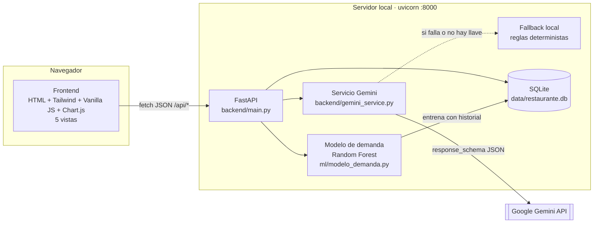
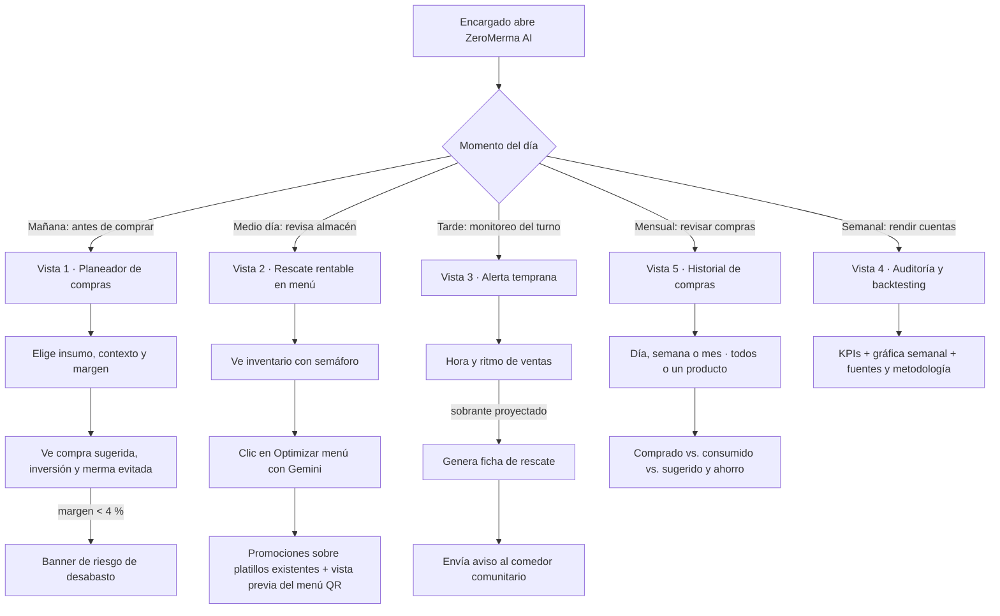
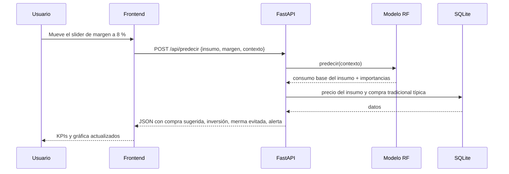

# 01 · Funciones del sistema y arquitectura

> **Apartado 1 · Orden 1.1** de la Tabla de Medios y Fines.
> Estado: ✅ definido. Los apartados siguientes construyen sobre este documento.

## 1. Objetivo

Definir **qué hace** ZeroMerma AI, **cómo se organiza** el código y **cómo se comunican** sus partes, antes de escribir el backend, el modelo y la integración con Gemini. Este documento es el contrato que siguen los 5 integrantes del equipo.

## 2. Problema y propuesta

Un restaurante de plaza comercial compra insumos perecederos **por intuición**. Si compra de más, el excedente caduca en almacén (merma). Si recorta al tanteo, se queda sin platillos en hora pico (desabasto o *stockout*).

ZeroMerma AI ataca el problema en tres momentos del día:

| Momento | Pregunta del encargado | Módulo | Tecnología |
|---|---|---|---|
| Antes de comprar (mañana) | ¿Cuánto compro hoy? | Planeador de compras | Random Forest (scikit-learn) |
| Durante el día | Tengo insumos por caducar, ¿cómo los vendo? | Rescate rentable en menú | Gemini con salida JSON |
| Antes del cierre | Me va a sobrar comida, ¿a quién aviso? | Alerta temprana de excedentes | Proyección de ventas + Gemini |

Y una cuarta vista demuestra el impacto: **Auditoría y backtesting**.

## 3. Funciones del sistema

### Requisitos funcionales

| ID | Función | Vista | Endpoint |
|---|---|---|---|
| RF-01 | Predecir los comensales del día a partir de calendario (día de la semana, quincena, días festivos, época del año), clima y eventos (cercanos y en la plaza). | 1 | `POST /api/predecir` |
| RF-02 | Calcular la compra sugerida por insumo: `predicción base × (1 + margen de seguridad)`. | 1 | `POST /api/predecir` |
| RF-03 | Permitir ajustar el margen de seguridad (0 % a 25 %) y recalcular al instante. | 1 | `POST /api/predecir` |
| RF-04 | Alertar riesgo de desabasto si el margen es menor a 4 %. | 1 | `POST /api/predecir` |
| RF-05 | Mostrar la importancia de variables del modelo (explicabilidad). | 1 | `POST /api/predecir` |
| RF-06 | Comparar la compra sugerida contra la compra tradicional: merma evitada en unidades y $MXN. | 1 | `POST /api/predecir` |
| RF-07 | Listar el inventario por lote con horas para caducar y semáforo (rojo < 24 h, ámbar < 72 h, verde). | 2 | `GET /api/inventario` |
| RF-08 | Cruzar insumos a menos de 24 h de caducar con el recetario y proponer promociones **solo sobre platillos existentes**. | 2 | `POST /api/optimizar-menu` |
| RF-09 | Calcular que cada promoción sea rentable: precio de oferta mayor que el costo de insumos por porción. | 2 | `POST /api/optimizar-menu` |
| RF-10 | Redactar el texto promocional para el menú digital del comensal. | 2 | `POST /api/optimizar-menu` |
| RF-11 | Proyectar porciones sobrantes al cierre según la hora y el ritmo de ventas. | 3 | `POST /api/alerta-excedente` |
| RF-12 | Generar una ficha de rescate (alimento, cantidad, ventana de recolección, nota de inocuidad). | 3 | `POST /api/alerta-excedente` |
| RF-13 | Comparar día a día compra tradicional, demanda real y compra sugerida (backtesting). | 4 | `GET /api/auditoria` |
| RF-16 | Consultar lo que se compró cada día según la base, agrupado por día, semana o mes, para todos los productos o uno, y cuánto se habría ahorrado con el modelo. | 5 | `GET /api/historial-compras` |
| RF-14 | Mostrar en toda la interfaz que los datos son **SIMULADOS**. | Todas | Campo `origen_dato` en cada respuesta |
| RF-15 | Funcionar sin internet hacia Gemini: modo *fallback* con respuestas calculadas localmente. | 2 y 3 | Campo `modo` en la respuesta |

### Requisitos no funcionales

| ID | Requisito | Cómo se cumple |
|---|---|---|
| RNF-01 | Arrancar con un solo comando. | FastAPI sirve la API y los archivos del frontend en el mismo puerto. |
| RNF-02 | Instalación mínima. | Python 3.10+, `pip install -r requirements.txt`. Frontend sin build (CDN). |
| RNF-03 | Datos reproducibles. | El generador usa semilla fija (`--semilla 42`). |
| RNF-04 | Transparencia de datos. | Columna `origen_dato` con `CHECK` en cada tabla; badge en la UI; sección en `/docs`. |
| RNF-05 | Sin secretos en el repo. | La llave de Gemini va en `.env` (ignorado por git); se incluye `.env.example`. |
| RNF-06 | Tolerancia a fallos de la IA. | Si Gemini falla o no hay cuota, se usa el *fallback* y la UI lo indica. |
| RNF-07 | Responsivo. | Tailwind; probado en 390 px y 1440 px. |

## 4. Arquitectura

### Diagrama de componentes



### Decisión: monolito ligero

Un solo proceso FastAPI sirve la API, el modelo y el frontend. Para un sprint de 24 h, con 5 personas y una demo local, esto evita configurar CORS entre puertos, Docker o un servidor web aparte. CORS queda habilitado de todas formas, para quien quiera abrir el frontend desde otro puerto mientras lo desarrolla.

### Stack y justificación

| Capa | Tecnología | Por qué |
|---|---|---|
| Base de datos | SQLite (archivo) | Cero instalación; viene con Python; el archivo se regenera con un script. |
| Datos simulados | Python estándar (`random`, `sqlite3`) | Sin dependencias; reproducible con semilla. |
| Modelo | scikit-learn `RandomForestRegressor` | Funciona bien con pocos datos tabulares, captura interacciones (quincena × fin de semana) y trae `feature_importances_` para explicar. |
| Backend | FastAPI + uvicorn | Valida entradas con Pydantic, genera documentación automática en `/docs` y es fácil de leer. |
| IA generativa | Google Gemini con el SDK `google-genai` y `response_schema` | La respuesta llega como JSON con estructura fija, no como texto libre de chatbot. |
| Frontend | HTML5, Tailwind (CDN), Vanilla JS, Chart.js, Lucide | Sin build ni Node.js. Parte del prototipo `prueba1/`. |

## 5. Estructura de carpetas

Las rutas marcadas con ✅ ya existen. Las demás se crean en el apartado indicado.

```text
Hackateate_2026/
├── README.md                      ✅ Apartado 7 · README maestro
├── requirements.txt               ✅ Apartado 7 · versiones probadas en Python 3.10 y 3.13
├── .env.example                   ✅ Apartado 6  (GEMINI_API_KEY=...)
├── .gitignore                     ✅
├── data/
│   ├── schema.sql                 ✅ Apartado 2 · esquema SQLite
│   ├── generar_datos.py           ✅ Apartado 2 · generador SIMULADO
│   └── restaurante.db             (se genera; no se sube a git)
├── ml/
│   ├── modelo_demanda.py          ✅ Apartado 3 · entrena, valida y predice compra
│   ├── modelo_rf.pkl              (se genera; no se sube a git)
│   └── metricas.json              (se genera; no se sube a git)
├── backend/
│   ├── main.py                    ✅ Apartado 4 · app FastAPI, modelos Pydantic, endpoints, estáticos
│   ├── database.py                ✅ Apartado 4 · conexión y consultas
│   ├── gemini_service.py          ✅ Apartado 6 · Gemini con response_schema + modo respaldo
│   └── services/
│       ├── rescate_menu.py        ✅ Apartado 4 · promociones (reglas + validación de Gemini)
│       ├── alerta_excedente.py    ✅ Apartado 4 · proyección y ficha de rescate
│       └── historial_compras.py   ✅ Vista 5 · compras por día, semana o mes vs. modelo
├── frontend/
│   ├── index.html                 ✅ Apartado 5 · 5 vistas
│   ├── app.js                     ✅ Apartado 5 · consume /api/* con respaldo local
│   └── datos_demo.js              ✅ Apartado 5 · respuestas precalculadas (modo demo autónoma)
├── scripts/
│   ├── exportar_datos_demo.py     ✅ Apartado 5 · genera frontend/datos_demo.js
│   ├── exportar_csv.py            ✅ exporta la base a CSV para Excel
│   └── prueba_humo.py             ✅ Apartado 7 · prueba de punta a punta por HTTP
├── prueba1/                       ✅ prototipo visual 100 % en navegador (referencia de diseño)
├── tests/
│   ├── test_generar_datos.py      ✅ Apartado 2
│   ├── test_modelo_demanda.py     ✅ Apartado 3
│   ├── test_api.py                ✅ Apartado 4
│   └── test_gemini_service.py     ✅ Apartado 6
└── docs/
    ├── 01_arquitectura.md         ✅ este documento
    ├── 02_base_de_datos.md        ✅
    ├── 03_modelo_ml.md            ✅ Apartado 3
    ├── 04_backend_api.md          ✅ Apartado 4
    ├── 05_frontend_ux.md          ✅ Apartado 5
    ├── 06_integracion_gemini.md   ✅ Apartado 6
    ├── 07_integracion_pruebas.md  ✅ Apartado 7
    └── 08_plan_negocios.md        Apartado 8
```

## 6. Contratos de la API

> La referencia completa y vigente de cada endpoint (parámetros, respuestas JSON reales y errores) está en **[`04_backend_api.md`](04_backend_api.md)**. Esta tabla es el resumen de diseño.

| Endpoint | Vista | Entrada principal | Salida principal |
|---|---|---|---|
| `GET /api/salud` | — | — | estado de base, modelo, Gemini y frontend |
| `GET /api/catalogo` | Todas | — | 46 insumos y 30 platillos con receta y costo |
| `GET /api/inventario` | 2 | `estado` (opcional) | lotes con `horas_restantes` y `estado` CRITICO / PRECAUCION / OPTIMO |
| `POST /api/predecir` | 1 | `insumo`, `dia_semana`, `es_quincena`, `lluvia`, `evento`, `evento_plaza`, `es_dia_festivo`, `epoca`, `margen_seguridad` | `clientes_estimados`, `compra_sugerida`, `costo_estimado_mxn`, `merma_evitada_mxn`, `riesgo_desabasto`, `importancia_variables` |
| `POST /api/optimizar-menu` | 2 | `horas_umbral`, `usar_gemini` | `modo` (gemini/fallback) y estrategias sobre platillos existentes |
| `POST /api/alerta-excedente` | 3 | `hora_actual`, `ritmo_ventas` | proyección de cierre y ficha de recolección |
| `POST /api/alerta-excedente/{id}/enviar` | 3 | — | envío SIMULADO registrado |
| `GET /api/auditoria` | 4 | `dias`, `insumo` | serie diaria y totales de merma evitada en kg y $MXN |
| `GET /api/historial-compras` | 5 | `agrupar`, `insumo` | compras registradas vs. consumo vs. sugerencia del modelo, y ahorro |

Todas las respuestas incluyen `es_simulado` mientras la base sea simulada.

## 7. Flujo UX de las 5 vistas



| Vista | Usuario | Entrada | Salida clave |
|---|---|---|---|
| 1. Planeador de compras (ML) | Encargado de compras | Fecha, insumo, contexto, margen | Compra sugerida, inversión, merma evitada, explicabilidad |
| 2. Rescate rentable (Gemini) | Chef / gerente | Clic en "Optimizar" | 2 o más promociones rentables y su texto para el menú |
| 3. Alerta temprana | Gerente de turno | Hora y ritmo de ventas | Ficha de rescate lista para enviar |
| 4. Auditoría | Dueño / jueces | Rango de días | Ahorro, kg rescatados, comparación diaria |

En todas las vistas, la barra superior muestra el badge **⚠️ Entorno de Validación: Datos Simulados**.

## 8. Flujo de datos de una predicción



## 9. Datos empleados

| Dato | Origen |
|---|---|
| Historial de ventas, afluencia, clima, inventario, recetario y precios | **SIMULADO** (ver `02_base_de_datos.md`) |
| Contexto del desperdicio de alimentos, precios de referencia | **REAL**, se citará en los apartados 3 y 8 con su fuente (FAO/PNUMA, PROFECO, INEGI) |

## 10. Cómo verificar este apartado

1. La estructura de carpetas del repositorio coincide con la sección 5 (las rutas ✅ existen).
2. Cada vista del prototipo `prueba1/` corresponde a una función RF de la sección 3.
3. Cada endpoint de la sección 6 tiene un requisito funcional que lo justifica, y viceversa.
