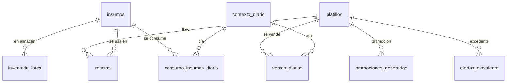

# 02 · Base de datos SQLite y datos históricos simulados

> **Apartado 2 · Orden 1.2** de la Tabla de Medios y Fines.
> Estado: ✅ implementado y probado (`tests/test_generar_datos.py`, 9 pruebas).

> ⚠️ **Todos los registros de esta base de datos son SIMULADOS.** Representan un restaurante hipotético de plaza comercial y no corresponden a ningún negocio real. Cada tabla tiene la columna `origen_dato` y la base rechaza cualquier registro que no diga `SIMULADO` o `REAL`.

## 1. Objetivo

Tener datos históricos suficientes y coherentes para:

- entrenar el modelo de demanda (Apartado 3),
- alimentar los endpoints del backend (Apartado 4),
- darle a Gemini un inventario con caducidades críticas y un recetario real del menú (Apartado 6),
- calcular el backtesting de la vista de auditoría.

## 2. Medios utilizados

| Medio | Para qué |
|---|---|
| SQLite (incluido en Python) | Base de datos en un solo archivo, sin servidor. |
| `data/schema.sql` | Define tablas, llaves y restricciones. |
| `data/generar_datos.py` | Crea la base y la llena. Solo usa la librería estándar. |
| `tests/test_generar_datos.py` | Verifica automáticamente que los datos cumplan las reglas. |

## 3. Cómo ejecutarlo

Desde la raíz del repositorio:

```bash
python data/generar_datos.py                    # crea data/zeromerma.db (180 días, semilla 42)
python data/generar_datos.py --solo-inventario  # justo antes de la demo: refresca las caducidades
python -m unittest discover -s tests -v         # corre las pruebas
```

Opciones: `--dias N` (mínimo 150), `--semilla N`, `--fecha-fin AAAA-MM-DD`, `--db ruta`, `--silencioso`.

Salida esperada (los números exactos cambian con la fecha de ejecución):

```text
Registros por tabla (todos SIMULADOS):
  insumos                        16
  platillos                      12
  recetas                        54
  contexto_diario               180
  ventas_diarias               2160
  consumo_insumos_diario       2880
  inventario_lotes               17
  TOTAL                        5319

Inventario a menos de 24 h de caducar:
  - Pechuga de pollo: 7.5 kg (caduca en 18.0 h)
  - Pan bolillo: 40.0 pza (caduca en 20.0 h)
  - Crema ácida: 4.0 L (caduca en 22.0 h)

Verificación OK: todos los registros están etiquetados como SIMULADO.
```

## 4. Modelo de datos



| Tabla | Una fila es… | Columnas clave | La usa |
|---|---|---|---|
| `meta_dataset` | un dato sobre el dataset | `clave`, `valor` (origen, semilla, fechas) | Backend `/api/salud` |
| `insumos` | un insumo que se compra | `unidad`, `precio_unitario_mxn`, `vida_util_dias`, `fuente_precio` | Todo |
| `platillos` | un platillo del menú vigente | `precio_venta_mxn`, `popularidad_base` | Gemini, alertas |
| `recetas` | cantidad de un insumo en una porción | `cantidad_por_porcion` | Consumo, costo por porción, Gemini |
| `contexto_diario` | un día de operación | `dia_semana`, `es_quincena`, `lluvia`, `temperatura_c`, `evento_cercano`, `temporada_vacacional`, `comensales` | Variables del modelo ML |
| `ventas_diarias` | porciones vendidas de un platillo en un día | `porciones_vendidas`, `ingreso_mxn` | Alertas, auditoría |
| `consumo_insumos_diario` | uso real de un insumo en un día vs. compra tradicional | `consumo_real` (**objetivo del ML**), `compra_tradicional`, `merma_tradicional`, `faltante_tradicional` | Modelo, backtesting |
| `inventario_lotes` | un lote en almacén | `cantidad`, `fecha_caducidad` | Vista 2, Gemini |
| `promociones_generadas` | una promoción que propuso el sistema | `modo` (`gemini`/`fallback`), `respuesta_json` | Bitácora (Apartado 6) |
| `alertas_excedente` | una ficha de rescate generada | `porciones_excedentes`, `ventana_inicio`, `ficha_json` | Bitácora (Apartado 6) |

## 5. Cómo se generan los datos (supuestos SIMULADOS)

Todos los supuestos están como constantes al inicio de `generar_datos.py`, para cambiarlos en un solo lugar.

### 5.1 Afluencia diaria (comensales)

```
comensales = base_del_día_de_la_semana
             × (1 + 0.12·quincena + 0.06·lluvia + 0.15·evento − 0.10·vacaciones)
             × tendencia (+3 % a lo largo del periodo)
             × ruido aleatorio (normal, desviación 7 %)
```

| Supuesto | Valor | Razonamiento |
|---|---|---|
| Base lunes a domingo | 118, 112, 122, 132, 168, 195, 172 | Plaza comercial: más gente viernes a domingo. |
| Quincena | +12 % | Día de pago y el siguiente; si cae en fin de semana, se paga el viernes. |
| Lluvia | +6 % | La plaza está techada: la gente se refugia y come ahí. |
| Evento cercano | +15 % | Concierto o evento universitario (más probable viernes y sábado). |
| Vacaciones escolares | −10 % | Menos estudiantes del campus cercano. |
| Probabilidad de lluvia | 5 % a 65 % según el mes | Perfil de temporada de lluvias del centro de México (junio a septiembre). |

### 5.2 Ventas por platillo

`porciones = comensales × popularidad del platillo × ajuste de contexto × ruido (10 %)`.

Ajustes: con lluvia se vende más sopa de tortilla (+35 %) y café (+25 %) y menos ensalada; en fin de semana más chilaquiles y huevos rancheros (+25 %); con calor, más agua fresca.

### 5.3 Consumo de insumos

`consumo_real = Σ (porciones vendidas × cantidad en la receta) × 1.03`

El 3 % extra es la merma normal al cocinar (recortes, pruebas). La prueba `test_consumo_cuadra_con_ventas_y_recetas` comprueba esta fórmula.

### 5.4 Compra tradicional "a ojo" (línea base contra la que se compara)

Simula al encargado que compra por intuición:

1. Toma el día **más fuerte** de la semana pasada para ese insumo.
2. Le agrega un colchón aleatorio de −5 % a +20 %.
3. En 8 % de los días recorta al tanteo un 25 % (aquí aparecen los desabastos).
4. Redondea al empaque del proveedor (0.5 kg, 0.5 L o pieza entera).

El sobrante que **caduca** depende de la vida útil del insumo:

| Vida útil | Fracción del sobrante que se tira |
|---|---|
| ≤ 2 días (tortilla, bolillo) | 90 % |
| ≤ 4 días (pollo, milanesa, lechuga, aguacate) | 50 % |
| ≤ 7 días | 25 % |
| ≤ 14 días | 10 % |
| más de 14 días (arroz, frijol, café, huevo) | 0 % |

### 5.5 Inventario actual

17 lotes con caducidad **relativa a la hora en que se corre el script**. Así la demo siempre tiene insumos críticos sin importar el día. Los cuatro primeros coinciden con el prototipo:

| Insumo | Cantidad | Caduca en | Semáforo |
|---|---|---|---|
| Pechuga de pollo | 7.5 kg | 18 h | 🔴 |
| Crema ácida | 4.0 L | 22 h | 🔴 |
| Jitomate saladet | 6.0 kg | 48 h | 🟡 |
| Arroz blanco | 12.0 kg | 15 días | 🟢 |
| Pan bolillo | 40 pza | 20 h | 🔴 |

El semáforo **no se guarda**: el backend lo calcula al consultar, porque cambia con cada hora que pasa.

## 6. Decisiones técnicas

| Decisión | Alternativa descartada | Motivo |
|---|---|---|
| SQLite en un archivo | PostgreSQL / MySQL | Sin servidor ni instalación; suficiente para un restaurante. |
| `origen_dato` con `CHECK` en cada tabla | Una nota en el README | La regla de etiquetado queda forzada por la base, no por disciplina. |
| Precio con columna `fuente_precio` | Precio sin fuente | La rúbrica pide citar fuentes; la columna muestra qué falta verificar. |
| Generador sin dependencias | pandas / numpy / Faker | Cualquiera lo corre con Python recién instalado. |
| Semilla fija | Datos aleatorios en cada ejecución | Todo el equipo ve los mismos números y el modelo es reproducible. |
| Caducidades relativas a "ahora" | Fechas fijas | En la demo siempre hay insumos a menos de 24 h. |
| Simular el consumo desde ventas × recetas | Simular el consumo directamente | El consumo queda coherente con lo vendido y con el recetario que usa Gemini. |
| `zeromerma.db` fuera de git | Subir el archivo | Se regenera en 1 segundo y evita conflictos de merge. |

## 7. Evidencia: SIMULADO vs. REAL

| Dato | Origen | Nota |
|---|---|---|
| Historial de afluencia, ventas, consumo, compras y merma | **SIMULADO** | Generado con los supuestos de la sección 5. |
| Recetario (gramos por porción) | **SIMULADO** | Porciones típicas de cocina mexicana, sin fuente formal. |
| Precios de venta del menú | **SIMULADO** | Rangos de una cafetería de plaza comercial. |
| Precios de insumos | **SIMULADO (provisional)** | La columna `fuente_precio` lo indica. **Pendiente:** reemplazar con los valores de PROFECO *Quién es Quién en los Precios* y registrar fecha de consulta y ciudad. |
| Perfil de lluvia por mes | **SIMULADO** con forma basada en la temporada de lluvias del centro de México | Si se quiere hacer REAL: usar normales climatológicas del Servicio Meteorológico Nacional (SMN/CONAGUA) y citarlas. |
| Calendario de quincenas | Regla real de pago (días 15 y último del mes) aplicada a datos simulados | |

### Pendiente para cumplir la regla de fuentes

Para cada insumo, consultar en PROFECO *Quién es Quién en los Precios* y actualizar en `generar_datos.py` la tupla del insumo en `INSUMOS` y el texto de `fuente_precio`, por ejemplo:
`"PROFECO QQP, consulta 2026-11-27, CDMX, promedio de supermercados"`. Hasta que eso ocurra, los precios deben presentarse ante los jueces como **SIMULADOS**.

## 8. Cómo verificar que funciona

1. `python data/generar_datos.py` termina con `Verificación OK`.
2. `python -m unittest discover -s tests -v` muestra 9 pruebas `ok`. Comprueban:
   - al menos 150 días de historial;
   - todas las tablas etiquetadas `SIMULADO`;
   - la base rechaza un registro con otra etiqueta;
   - hay al menos 2 lotes a menos de 24 h de caducar;
   - cada platillo tiene receta;
   - el consumo cuadra con ventas × recetas;
   - los fines de semana tienen más comensales;
   - la misma semilla produce los mismos datos;
   - la quincena se recorre al viernes si cae en domingo.
3. Consulta manual rápida:

```bash
python -c "import sqlite3; c=sqlite3.connect('data/zeromerma.db'); print(c.execute('SELECT * FROM meta_dataset').fetchall())"
```

## 9. Preguntas probables de los jueces

**¿Por qué datos simulados y no reales?**
No tenemos acceso a la operación de un restaurante en 24 h. Los datos simulados siguen reglas explícitas y documentadas, y cada registro está etiquetado. El sistema está listo para cargar datos reales: basta con insertar filas con `origen_dato = 'REAL'`.

**¿El modelo no aprenderá simplemente las reglas que ustedes inventaron?**
Sí, y es intencional para la validación: si el modelo no recupera reglas que sabemos que existen, el pipeline tiene un error. El ruido aleatorio (7 % y 10 %) impide que sea trivial. Con datos reales, el mismo pipeline aprende patrones desconocidos.

**¿Cómo saben que la merma tradicional es realista?**
No lo afirmamos: es un supuesto SIMULADO, documentado en la sección 5.4. Las cifras de contexto real del desperdicio se citan con su fuente en el plan de negocios (Apartado 8).
