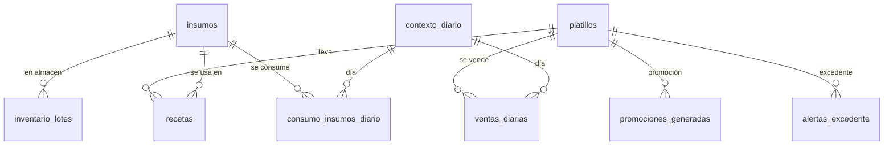

# 02 · Base de datos SQLite y datos históricos simulados

> **Apartado 2 · Orden 1.2** de la Tabla de Medios y Fines.
> Estado: ✅ implementado y probado (`tests/test_generar_datos.py`, 10 pruebas).

> ⚠️ **Todos los registros de esta base de datos son SIMULADOS.** Representan un restaurante hipotético de plaza comercial y no corresponden a ningún negocio real. Cada tabla tiene la columna `origen_dato` y la base rechaza cualquier registro que no diga `SIMULADO` o `REAL`.

## 1. Objetivo

Tener datos históricos suficientes y coherentes para:

- entrenar el modelo de demanda (Apartado 3),
- alimentar los endpoints del backend (Apartado 4),
- darle a Gemini un inventario con caducidades críticas y un recetario real del menú (Apartado 6),
- calcular el backtesting de la vista de auditoría.

## 2. Medios utilizados

| Medio | Para qué |
|---|---|
| SQLite (incluido en Python) | Base de datos en un solo archivo, sin servidor. |
| `data/schema.sql` | Define tablas, llaves y restricciones. |
| `data/generar_datos.py` | Crea la base y la llena. Solo usa la librería estándar. |
| `tests/test_generar_datos.py` | Verifica automáticamente que los datos cumplan las reglas. |

## 3. Cómo ejecutarlo

Desde la raíz del repositorio:

```bash
python data/generar_datos.py                    # crea data/zeromerma.db (180 días, semilla 42)
python data/generar_datos.py --solo-inventario  # justo antes de la demo: refresca las caducidades
python -m unittest discover -s tests -v         # corre las pruebas
```

Opciones: `--dias N` (mínimo 150), `--semilla N`, `--fecha-fin AAAA-MM-DD`, `--db ruta`, `--silencioso`.

Salida esperada (los números exactos cambian con la fecha de ejecución):

```text
Registros por tabla (todos SIMULADOS):
  insumos                        46
  platillos                      30
  recetas                       176
  contexto_diario               180
  ventas_diarias               5400
  consumo_insumos_diario       8280
  inventario_lotes               47
  TOTAL                       14159

Inventario a menos de 24 h de caducar:
  - Pechuga de pollo: 7.5 kg (caduca en 18.0 h)
  - Pan bolillo: 40.0 pza (caduca en 20.0 h)
  - Crema ácida: 4.0 L (caduca en 22.0 h)
  - Carne molida de res: 3.0 kg (caduca en 23.0 h)

Verificación OK: todos los registros están etiquetados como SIMULADO.
```

## 4. Modelo de datos



| Tabla | Una fila es… | Columnas clave | La usa |
|---|---|---|---|
| `meta_dataset` | un dato sobre el dataset | `clave`, `valor` (origen, semilla, fechas) | Backend `/api/salud` |
| `insumos` | un insumo que se compra | `unidad`, `precio_unitario_mxn`, `vida_util_dias`, `fuente_precio` | Todo |
| `platillos` | uno de los 30 platillos del menú vigente | `precio_venta_mxn`, `popularidad_base` | Gemini, alertas |
| `recetas` | cantidad de un insumo en una porción | `cantidad_por_porcion` | Consumo, costo por porción, Gemini |
| `contexto_diario` | un día de operación | `dia_semana`, `es_quincena`, `lluvia`, `temperatura_c`, `evento_cercano`, `temporada_vacacional`, `comensales` | Variables del modelo ML |
| `ventas_diarias` | porciones vendidas de un platillo en un día | `porciones_vendidas`, `ingreso_mxn` | Alertas, auditoría |
| `consumo_insumos_diario` | uso real de un insumo en un día vs. compra tradicional | `consumo_real` (**objetivo del ML**), `compra_tradicional`, `merma_tradicional`, `faltante_tradicional` | Modelo, backtesting |
| `inventario_lotes` | un lote en almacén | `cantidad`, `fecha_caducidad` | Vista 2, Gemini |
| `promociones_generadas` | una promoción que propuso el sistema | `modo` (`gemini`/`fallback`), `respuesta_json` | Bitácora (Apartado 6) |
| `alertas_excedente` | una ficha de rescate generada | `porciones_excedentes`, `ventana_inicio`, `ficha_json` | Bitácora (Apartado 6) |

### 4.1 Menú vigente y recetario (30 platillos, 46 insumos) · SIMULADO

El menú tiene **24 platillos principales** (16 platos fuertes, 5 desayunos y 3 sopas), **1 postre** y **5 bebidas**. Cada platillo tiene su receta por porción y cada insumo aparece en al menos una receta y en al menos un lote del inventario. El script se niega a generar la base si el catálogo no cumple estas reglas (`verificar_catalogo()`).

**Insumos por categoría** (vida útil en días):

| Categoría | Insumos (unidad · vida útil) |
|---|---|
| proteína | Pechuga de pollo (kg · 3 d), Milanesa de res (kg · 3 d), Bistec de res (kg · 3 d), Carne molida de res (kg · 2 d), Carne de cerdo (pierna) (kg · 3 d), Jamón de pavo (kg · 7 d), Tocino (kg · 7 d), Huevo blanco (kg · 21 d) |
| lácteo | Crema ácida (L · 7 d), Queso manchego (kg · 14 d), Queso fresco (kg · 7 d), Leche entera (L · 7 d), Mantequilla (kg · 30 d) |
| panadería | Tortilla de maíz (kg · 2 d), Masa de maíz para tamal (kg · 2 d), Pan bolillo (pza · 1 d), Pan para hamburguesa (pza · 4 d), Pan de caja (kg · 5 d) |
| verdura | Jitomate saladet (kg · 5 d), Tomate verde (kg · 7 d), Cebolla blanca (kg · 10 d), Lechuga romana (kg · 4 d), Chile serrano (kg · 7 d), Cilantro (kg · 4 d), Rábano (kg · 5 d), Papa blanca (kg · 14 d), Zanahoria (kg · 14 d), Calabacita (kg · 6 d), Maíz pozolero precocido (kg · 5 d) |
| fruta | Aguacate hass (kg · 4 d), Fruta de temporada (aguas) (kg · 4 d), Piña (kg · 5 d), Plátano tabasco (kg · 5 d), Naranja para jugo (kg · 10 d), Limón sin semilla (kg · 10 d) |
| abarrote | Arroz blanco (kg · 365 d), Frijol negro (kg · 365 d), Café en grano (kg · 90 d), Aceite vegetal (L · 180 d), Harina de trigo (kg · 180 d), Azúcar estándar (kg · 365 d), Pan molido (kg · 90 d), Chile guajillo seco (kg · 180 d), Chile chipotle en adobo (kg · 180 d), Pasta de mole poblano (kg · 90 d), Leche condensada (kg · 180 d) |

**Recetario.** Las cantidades son por porción. El costo de insumos usa los precios SIMULADOS provisionales de la tabla `insumos`; la columna "Costo / precio" es la referencia que usará el Apartado 6 para que una promoción no venda por debajo del costo.

#### Platos fuertes (16)

| # | Platillo | Precio | Receta por porción | Costo de insumos | Costo / precio |
|---|---|---|---|---|---|
| 1 | Enchiladas Suizas | $120 | Pechuga de pollo 180 g, Crema ácida 60 ml, Tortilla de maíz 120 g, Queso manchego 50 g, Tomate verde 100 g, Cebolla blanca 20 g | $44.55 | 37% |
| 2 | Chilaquiles Especiales con Pollo | $110 | Tortilla de maíz 150 g, Pechuga de pollo 150 g, Crema ácida 40 ml, Queso manchego 30 g, Jitomate saladet 100 g, Cebolla blanca 20 g, Frijol negro 60 g, Aceite vegetal 20 ml | $38.98 | 35% |
| 3 | Torta de Milanesa | $95 | Pan bolillo 1 pza, Milanesa de res 150 g, Aguacate hass 40 g, Jitomate saladet 40 g, Frijol negro 40 g, Lechuga romana 20 g, Aceite vegetal 20 ml | $37.09 | 39% |
| 4 | Pollo a la Plancha con Arroz | $125 | Pechuga de pollo 220 g, Arroz blanco 100 g, Frijol negro 60 g, Lechuga romana 40 g, Jitomate saladet 40 g, Aceite vegetal 10 ml | $38.35 | 31% |
| 5 | Tacos de Pollo (orden de 3) | $90 | Tortilla de maíz 100 g, Pechuga de pollo 140 g, Cebolla blanca 20 g, Aguacate hass 40 g, Tomate verde 40 g, Cilantro 10 g | $26.50 | 29% |
| 6 | Quesadillas de Queso (3 pzas) | $80 | Tortilla de maíz 120 g, Queso manchego 80 g, Crema ácida 20 ml | $19.44 | 24% |
| 7 | Ensalada César con Pollo | $105 | Lechuga romana 150 g, Pechuga de pollo 120 g, Queso manchego 20 g, Huevo blanco 20 g, Pan de caja 20 g, Limón sin semilla 10 g | $28.39 | 27% |
| 8 | Enfrijoladas con Queso Fresco | $85 | Tortilla de maíz 120 g, Frijol negro 100 g, Crema ácida 30 ml, Queso fresco 40 g, Cebolla blanca 20 g | $13.84 | 16% |
| 9 | Flautas de Pollo (4 pzas) | $95 | Tortilla de maíz 100 g, Pechuga de pollo 100 g, Aceite vegetal 30 ml, Lechuga romana 40 g, Crema ácida 30 ml, Queso fresco 30 g, Jitomate saladet 40 g | $25.43 | 27% |
| 10 | Tostadas de Tinga de Pollo (3 pzas) | $85 | Tortilla de maíz 80 g, Pechuga de pollo 120 g, Jitomate saladet 80 g, Cebolla blanca 30 g, Chile chipotle en adobo 10 g, Frijol negro 40 g, Crema ácida 20 ml, Lechuga romana 30 g, Aceite vegetal 20 ml | $27.52 | 32% |
| 11 | Tacos al Pastor (orden de 4) | $95 | Tortilla de maíz 100 g, Carne de cerdo (pierna) 150 g, Piña 30 g, Cebolla blanca 20 g, Cilantro 10 g, Chile guajillo seco 5 g, Limón sin semilla 20 g | $23.75 | 25% |
| 12 | Hamburguesa Clásica con Papas | $135 | Pan para hamburguesa 1 pza, Carne molida de res 150 g, Queso manchego 30 g, Lechuga romana 20 g, Jitomate saladet 30 g, Cebolla blanca 20 g, Papa blanca 150 g, Aceite vegetal 30 ml | $41.96 | 31% |
| 13 | Club Sándwich con Papas | $125 | Pan de caja 90 g, Jamón de pavo 50 g, Pechuga de pollo 80 g, Tocino 30 g, Queso manchego 30 g, Lechuga romana 20 g, Jitomate saladet 30 g, Papa blanca 120 g, Aceite vegetal 30 ml | $40.47 | 32% |
| 14 | Pechuga Empanizada con Arroz | $125 | Pechuga de pollo 200 g, Pan molido 30 g, Huevo blanco 30 g, Aceite vegetal 40 ml, Arroz blanco 100 g, Lechuga romana 40 g, Jitomate saladet 30 g | $37.23 | 30% |
| 15 | Bistec a la Mexicana | $130 | Bistec de res 180 g, Jitomate saladet 80 g, Cebolla blanca 30 g, Chile serrano 10 g, Arroz blanco 100 g, Frijol negro 60 g, Tortilla de maíz 60 g, Aceite vegetal 10 ml | $45.16 | 35% |
| 16 | Enmoladas de Pollo | $115 | Tortilla de maíz 120 g, Pechuga de pollo 140 g, Pasta de mole poblano 80 g, Crema ácida 30 ml, Queso fresco 30 g, Cebolla blanca 20 g | $40.64 | 35% |

#### Desayunos (5)

| # | Platillo | Precio | Receta por porción | Costo de insumos | Costo / precio |
|---|---|---|---|---|---|
| 17 | Molletes con Pico de Gallo | $75 | Pan bolillo 1 pza, Frijol negro 80 g, Queso manchego 50 g, Jitomate saladet 40 g, Cebolla blanca 20 g, Cilantro 5 g | $17.91 | 24% |
| 18 | Huevos Rancheros | $85 | Huevo blanco 120 g, Tortilla de maíz 60 g, Jitomate saladet 100 g, Frijol negro 60 g, Cebolla blanca 20 g, Aceite vegetal 10 ml | $13.33 | 16% |
| 19 | Huevos a la Mexicana | $80 | Huevo blanco 120 g, Jitomate saladet 60 g, Cebolla blanca 30 g, Chile serrano 10 g, Frijol negro 60 g, Tortilla de maíz 60 g, Aceite vegetal 10 ml | $12.96 | 16% |
| 20 | Hotcakes con Plátano (3 pzas) | $85 | Harina de trigo 100 g, Huevo blanco 50 g, Leche entera 120 ml, Mantequilla 20 g, Azúcar estándar 30 g, Plátano tabasco 50 g | $13.46 | 16% |
| 21 | Tamales Verdes de Pollo (2 pzas) | $70 | Masa de maíz para tamal 200 g, Pechuga de pollo 80 g, Tomate verde 60 g, Aceite vegetal 30 ml, Chile serrano 5 g | $18.57 | 27% |

#### Sopas (3)

| # | Platillo | Precio | Receta por porción | Costo de insumos | Costo / precio |
|---|---|---|---|---|---|
| 22 | Sopa de Tortilla | $70 | Tortilla de maíz 60 g, Jitomate saladet 120 g, Crema ácida 30 ml, Aguacate hass 30 g, Queso manchego 20 g, Cebolla blanca 20 g, Chile guajillo seco 3 g, Aceite vegetal 10 ml | $14.58 | 21% |
| 23 | Pozole Rojo de Cerdo | $125 | Maíz pozolero precocido 120 g, Carne de cerdo (pierna) 150 g, Chile guajillo seco 10 g, Lechuga romana 40 g, Rábano 20 g, Cebolla blanca 20 g, Limón sin semilla 20 g, Tortilla de maíz 40 g | $28.82 | 23% |
| 24 | Caldo de Pollo con Verduras | $95 | Pechuga de pollo 150 g, Arroz blanco 50 g, Zanahoria 50 g, Papa blanca 50 g, Calabacita 50 g, Cebolla blanca 20 g, Cilantro 10 g, Limón sin semilla 20 g, Tortilla de maíz 40 g | $28.51 | 30% |

#### Postre (1)

| # | Platillo | Precio | Receta por porción | Costo de insumos | Costo / precio |
|---|---|---|---|---|---|
| 25 | Flan Napolitano | $45 | Huevo blanco 60 g, Leche entera 100 ml, Leche condensada 60 g, Azúcar estándar 20 g | $10.48 | 23% |

#### Bebidas (5)

| # | Platillo | Precio | Receta por porción | Costo de insumos | Costo / precio |
|---|---|---|---|---|---|
| 26 | Agua Fresca del Día (500 ml) | $35 | Fruta de temporada (aguas) 120 g, Azúcar estándar 30 g | $5.10 | 15% |
| 27 | Café Americano | $35 | Café en grano 12 g | $3.84 | 11% |
| 28 | Limonada Natural (500 ml) | $30 | Limón sin semilla 80 g, Azúcar estándar 40 g | $4.00 | 13% |
| 29 | Jugo de Naranja (400 ml) | $40 | Naranja para jugo 450 g | $9.90 | 25% |
| 30 | Licuado de Plátano (400 ml) | $45 | Leche entera 250 ml, Plátano tabasco 120 g, Azúcar estándar 20 g | $10.24 | 23% |

Para agregar o cambiar un platillo: edita `PLATILLOS` y `RECETAS` en `data/generar_datos.py` (y `INSUMOS` y `LOTES_INVENTARIO` si usa un insumo nuevo), corre el script y las pruebas. Si la popularidad de los principales deja de sumar 1.0, el script lo avisa.

## 5. Cómo se generan los datos (supuestos SIMULADOS)

Todos los supuestos están como constantes al inicio de `generar_datos.py`, para cambiarlos en un solo lugar.

### 5.1 Afluencia diaria (comensales)

```
comensales = base_del_día_de_la_semana
             × (1 + 0.12·quincena + 0.06·lluvia + 0.15·evento − 0.10·vacaciones)
             × tendencia (+3 % a lo largo del periodo)
             × ruido aleatorio (normal, desviación 7 %)
```

| Supuesto | Valor | Razonamiento |
|---|---|---|
| Base lunes a domingo | 118, 112, 122, 132, 168, 195, 172 | Plaza comercial: más gente viernes a domingo. |
| Quincena | +12 % | Día de pago y el siguiente; si cae en fin de semana, se paga el viernes. |
| Lluvia | +6 % | La plaza está techada: la gente se refugia y come ahí. |
| Evento cercano | +15 % | Concierto o evento universitario (más probable viernes y sábado). |
| Vacaciones escolares | −10 % | Menos estudiantes del campus cercano. |
| Probabilidad de lluvia | 5 % a 65 % según el mes | Perfil de temporada de lluvias del centro de México (junio a septiembre). |

### 5.2 Ventas por platillo

`porciones = comensales × popularidad del platillo × ajuste de contexto × ruido (10 %)`.

- **Popularidad:** en los 24 principales es la fracción de comensales que lo pide (suman 1.0). En bebidas y postre es la fracción que además lo agrega (por ejemplo, 40 % pide agua fresca).
- **Ajustes de contexto** (constantes `AJUSTE_*` en el script):

| Contexto | Sube | Baja |
|---|---|---|
| Lluvia | Sopa de tortilla y caldo de pollo (+35 %), pozole (+30 %), café (+25 %) | Ensalada (−20 %), limonada (−20 %), agua fresca (−15 %), jugo (−10 %) |
| Fin de semana | Hotcakes (+30 %), chilaquiles, huevos rancheros y pozole (+25 %), huevos a la mexicana, tamales, jugo y flan (+20 %) | |
| Quincena | Hamburguesa, bistec y flan (+15 %), club sándwich y tacos al pastor (+10 %) | |
| Calor (≥ 22 °C) | Limonada (+25 %), agua fresca (+20 %), licuado (+10 %) | |

Resultado en el historial generado: lo más vendido son las bebidas (agua fresca, unas 58 al día) y entre los platillos, chilaquiles (≈ 12 al día) y enchiladas (≈ 11). Los menos pedidos rondan 5 porciones al día.

### 5.3 Consumo de insumos

`consumo_real = Σ (porciones vendidas × cantidad en la receta) × 1.03`

El 3 % extra es la merma normal al cocinar (recortes, pruebas). La prueba `test_consumo_cuadra_con_ventas_y_recetas` comprueba esta fórmula.

### 5.4 Compra tradicional "a ojo" (línea base contra la que se compara)

Simula al encargado que compra por intuición:

1. Toma el día **más fuerte** de la semana pasada para ese insumo.
2. Le agrega un colchón aleatorio de −5 % a +20 %.
3. En 8 % de los días recorta al tanteo un 25 % (aquí aparecen los desabastos).
4. Redondea al empaque del proveedor (0.5 kg, 0.5 L o pieza entera).

El sobrante que **caduca** depende de la vida útil del insumo:

| Vida útil | Fracción del sobrante que se tira |
|---|---|
| ≤ 2 días (tortilla, masa, bolillo, carne molida) | 90 % |
| ≤ 4 días (pollo, res, cerdo, lechuga, cilantro, aguacate, fruta, pan de hamburguesa) | 50 % |
| ≤ 7 días (crema, lácteos frescos, jitomate, pan de caja, jamón, tocino) | 25 % |
| ≤ 14 días (queso manchego, cebolla, naranja, limón, papa, zanahoria) | 10 % |
| más de 14 días (huevo, mantequilla y abarrotes) | 0 % |

### 5.5 Inventario actual

47 lotes (al menos uno por insumo) con caducidad **relativa a la hora en que se corre el script**. Así la demo siempre tiene insumos críticos sin importar el día. Los cuatro primeros coinciden con el prototipo:

| Insumo | Cantidad | Caduca en | Semáforo |
|---|---|---|---|
| Pechuga de pollo | 7.5 kg | 18 h | 🔴 |
| Crema ácida | 4.0 L | 22 h | 🔴 |
| Jitomate saladet | 6.0 kg | 48 h | 🟡 |
| Arroz blanco | 12.0 kg | 15 días | 🟢 |
| Pan bolillo | 40 pza | 20 h | 🔴 |
| Carne molida de res | 3.0 kg | 23 h | 🔴 |

El semáforo **no se guarda**: el backend lo calcula al consultar, porque cambia con cada hora que pasa.

## 6. Decisiones técnicas

| Decisión | Alternativa descartada | Motivo |
|---|---|---|
| SQLite en un archivo | PostgreSQL / MySQL | Sin servidor ni instalación; suficiente para un restaurante. |
| `origen_dato` con `CHECK` en cada tabla | Una nota en el README | La regla de etiquetado queda forzada por la base, no por disciplina. |
| Precio con columna `fuente_precio` | Precio sin fuente | La rúbrica pide citar fuentes; la columna muestra qué falta verificar. |
| Generador sin dependencias | pandas / numpy / Faker | Cualquiera lo corre con Python recién instalado. |
| Semilla fija | Datos aleatorios en cada ejecución | Todo el equipo ve los mismos números y el modelo es reproducible. |
| Caducidades relativas a "ahora" | Fechas fijas | En la demo siempre hay insumos a menos de 24 h. |
| Simular el consumo desde ventas × recetas | Simular el consumo directamente | El consumo queda coherente con lo vendido y con el recetario que usa Gemini. |
| `zeromerma.db` fuera de git | Subir el archivo | Se regenera en 1 segundo y evita conflictos de merge. |

## 7. Evidencia: SIMULADO vs. REAL

| Dato | Origen | Nota |
|---|---|---|
| Historial de afluencia, ventas, consumo, compras y merma | **SIMULADO** | Generado con los supuestos de la sección 5. |
| Recetario (gramos por porción) | **SIMULADO** | Porciones típicas de cocina mexicana, sin fuente formal. |
| Precios de venta del menú | **SIMULADO** | Rangos de una cafetería de plaza comercial. |
| Precios de insumos | **SIMULADO (provisional)** | La columna `fuente_precio` lo indica. **Pendiente:** reemplazar con los valores de PROFECO *Quién es Quién en los Precios* y registrar fecha de consulta y ciudad. |
| Perfil de lluvia por mes | **SIMULADO** con forma basada en la temporada de lluvias del centro de México | Si se quiere hacer REAL: usar normales climatológicas del Servicio Meteorológico Nacional (SMN/CONAGUA) y citarlas. |
| Calendario de quincenas | Regla real de pago (días 15 y último del mes) aplicada a datos simulados | |

### Pendiente para cumplir la regla de fuentes

Para cada insumo, consultar en PROFECO *Quién es Quién en los Precios* y actualizar en `generar_datos.py` la tupla del insumo en `INSUMOS` y el texto de `fuente_precio`, por ejemplo:
`"PROFECO QQP, consulta 2026-11-27, CDMX, promedio de supermercados"`. Hasta que eso ocurra, los precios deben presentarse ante los jueces como **SIMULADOS**.

## 8. Cómo verificar que funciona

1. `python data/generar_datos.py` termina con `Verificación OK`.
2. `python -m unittest discover -s tests -v` muestra 10 pruebas `ok`. Comprueban:
   - al menos 150 días de historial;
   - todas las tablas etiquetadas `SIMULADO`;
   - la base rechaza un registro con otra etiqueta;
   - hay al menos 2 lotes a menos de 24 h de caducar;
   - el menú tiene 30 platillos y el catálogo es consistente (recetas, insumos, lotes, popularidades);
   - cada platillo tiene receta;
   - el consumo cuadra con ventas × recetas;
   - los fines de semana tienen más comensales;
   - la misma semilla produce los mismos datos;
   - la quincena se recorre al viernes si cae en domingo.
3. Consulta manual rápida:

```bash
python -c "import sqlite3; c=sqlite3.connect('data/zeromerma.db'); print(c.execute('SELECT * FROM meta_dataset').fetchall())"
```

## 9. Preguntas probables de los jueces

**¿Por qué datos simulados y no reales?**
No tenemos acceso a la operación de un restaurante en 24 h. Los datos simulados siguen reglas explícitas y documentadas, y cada registro está etiquetado. El sistema está listo para cargar datos reales: basta con insertar filas con `origen_dato = 'REAL'`.

**¿El modelo no aprenderá simplemente las reglas que ustedes inventaron?**
Sí, y es intencional para la validación: si el modelo no recupera reglas que sabemos que existen, el pipeline tiene un error. El ruido aleatorio (7 % y 10 %) impide que sea trivial. Con datos reales, el mismo pipeline aprende patrones desconocidos.

**¿Cómo saben que la merma tradicional es realista?**
No lo afirmamos: es un supuesto SIMULADO, documentado en la sección 5.4. Las cifras de contexto real del desperdicio se citan con su fuente en el plan de negocios (Apartado 8).
