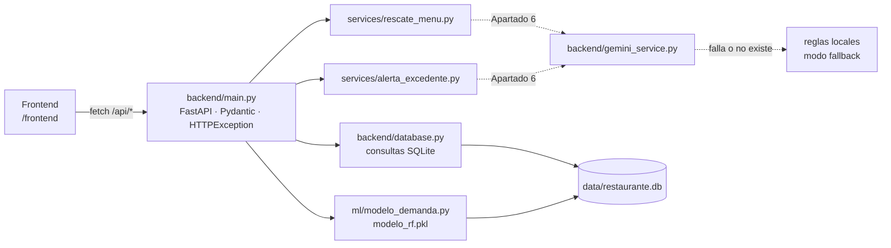

# 04 · Backend y API REST (FastAPI)

> **Apartado 4 · Orden 2.1** de la Tabla de Medios y Fines.
> Estado: ✅ implementado y probado (`tests/test_api.py`, 19 pruebas). Total del repositorio: 65 pruebas.

> ⚠️ **Todas las respuestas provienen de datos SIMULADOS.** Cada respuesta incluye `es_simulado: true`, y los lotes del inventario lo indican uno por uno.

## 1. Objetivo

Exponer la base de datos (Apartado 2), el modelo (Apartado 3) y la IA generativa (Apartado 6) como una API REST, y servir el frontend (Apartado 5) desde el mismo servidor. Un juez abre **una sola dirección** y usa todo el sistema.

## 2. Arranque en un paso

```bash
pip install -r requirements.txt
python backend/main.py                  # o: uvicorn backend.main:app --reload
```

- Aplicación: <http://localhost:8000>. Mientras no exista `/frontend` (Apartado 5), la raíz muestra una página que enlaza a la documentación.
- Documentación interactiva (Swagger): <http://localhost:8000/docs>. Ahí se puede probar cada endpoint desde el navegador.

**Preparación automática.** Al arrancar, el servidor revisa qué falta y lo prepara:

| Situación | Acción |
|---|---|
| No existe `data/restaurante.db` | Genera los datos SIMULADOS (Apartado 2). |
| No hay lotes vigentes a menos de 24 h (datos de otro día) | Refresca las caducidades del inventario. |
| No existe `ml/modelo_rf.pkl` | Entrena el modelo (Apartado 3, ≈ 5 s). |

Se desactiva con `OPSIA_AUTOPREPARAR=0`.

| Variable de entorno | Uso | Valor por defecto |
|---|---|---|
| `OPSIA_DB` | Ruta de la base SQLite | `data/restaurante.db` |
| `OPSIA_MODELO` | Ruta del modelo | `ml/modelo_rf.pkl` |
| `OPSIA_AUTOPREPARAR` | `0` desactiva la preparación automática | `1` |
| `PORT` | Puerto con `python backend/main.py` | `8000` |
| `GEMINI_API_KEY` | Llave de Gemini (también se lee de `.env`) | sin definir → modo `fallback` |
| `GEMINI_MODEL` · `GEMINI_TIMEOUT_MS` | Modelo y tiempo máximo de espera | `gemini-3.5-flash-lite` · `15000` |

## 3. Arquitectura del backend



| Archivo | Responsabilidad |
|---|---|
| `backend/main.py` | App FastAPI, CORS, modelos Pydantic, endpoints, manejo de errores, archivos estáticos y preparación al arrancar. |
| `backend/database.py` | Rutas configurables, conexión (`sesion()` abre y cierra), semáforo de caducidad, menú con recetas y costos, ventas promedio. |
| `backend/services/rescate_menu.py` | Promociones: reglas locales, validación de lo que proponga Gemini y bitácora. |
| `backend/services/alerta_excedente.py` | Proyección de sobrante, ventana de recolección, ficha de rescate y bitácora. |
| `ml/modelo_demanda.py` | `predecir_compra()` y predicciones históricas fuera de muestra (Apartado 3). |

### Cómo viaja una petición

1. El frontend llama, por ejemplo, `POST /api/predecir` con JSON.
2. **Pydantic** valida el cuerpo: tipos y rangos (día 0–6, margen 0–0.25). Si algo no cumple, responde **422** sin ejecutar nada.
3. El endpoint llama al módulo correspondiente: el modelo `.pkl` para predicciones, SQLite para inventario y recetas, o el servicio de Gemini para promociones.
4. Los errores de negocio se convierten en `HTTPException`: **400** entrada inválida, **404** no existe, **503** faltan datos o modelo.
5. La respuesta pasa por un `response_model` de Pydantic, que garantiza la forma del JSON que recibe el frontend.

### Gemini y su respaldo

`/api/optimizar-menu` y `/api/alerta-excedente` llaman a `backend/gemini_service.py` (detalle en [`06_integracion_gemini.md`](06_integracion_gemini.md)). Si no hay llave, falla la red, se acaba la cuota o la respuesta no es válida, usan **reglas locales**. La respuesta lo indica con `modo` (`gemini` o `fallback`) y `motivo_fallback`.

**El backend no confía en las cuentas de Gemini.** De su propuesta solo toma el platillo, el descuento, el tipo y el texto. Antes de aceptarla comprueba que:
1. el platillo exista en el menú vigente;
2. use al menos un insumo crítico;
3. el precio de oferta sea al menos 1.5 × el costo de insumos.

Después recalcula todas las cifras. Si algo falla, responde con el modo `fallback`.

## 4. Referencia de endpoints

Convenciones:
- cantidades en la unidad del insumo (`kg`, `L` o `pza`);
- dinero en pesos mexicanos (`_mxn`);
- horas en formato 24 h (`HH:MM`);
- fechas en ISO 8601.

Los ejemplos son respuestas reales del servidor con datos SIMULADOS del 2026-11-26 (algunas listas recortadas).

### 4.1 `GET /api/salud`

Estado del sistema.

```json
{ "estado": "ok", "base_datos": true, "modelo_cargado": true, "gemini_configurado": false,
  "frontend": false, "origen_dato": "SIMULADO", "es_simulado": true }
```

### 4.2 `GET /api/catalogo`

Insumos (46) y platillos (30), con receta y costo por porción. Sirve para llenar selectores.

```json
{ "insumos": [ { "clave": "aceite", "nombre": "Aceite vegetal", "categoria": "abarrote", "unidad": "L",
                 "precio_unitario_mxn": 45.0, "vida_util_dias": 180 } ],
  "platillos": [ { "clave": "enchiladas_suizas", "nombre": "Enchiladas Suizas", "categoria": "plato fuerte",
                   "precio_venta_mxn": 120.0, "costo_porcion_mxn": 44.55,
                   "receta": { "pollo": 0.18, "crema": 0.06, "tortilla": 0.12 } } ],
  "es_simulado": true }
```

### 4.3 `GET /api/inventario` · Vista 2

Lotes del almacén ordenados de menos a más horas para caducar.

| Parámetro (query) | Tipo | Por defecto | Descripción |
|---|---|---|---|
| `estado` | `CRITICO` \| `PRECAUCION` \| `OPTIMO` | todos | Filtra por semáforo. |
| `incluir_caducados` | bool | `true` | Incluir lotes ya vencidos. |

Semáforo: **CRITICO** < 24 h · **PRECAUCION** ≤ 48 h · **OPTIMO** > 48 h. Se calcula en cada consulta con la hora del servidor, no se guarda.

```json
{ "consultado_en": "2026-11-26T05:15:46",
  "resumen": { "CRITICO": 4, "PRECAUCION": 5, "OPTIMO": 38, "caducados": 0 },
  "lotes": [ { "lote_id": 1, "clave": "pollo", "insumo": "Pechuga de pollo", "categoria": "proteína",
               "cantidad": 7.5, "unidad": "kg", "ubicacion": "refrigerador",
               "fecha_caducidad": "2026-11-26T22:57:05", "horas_restantes": 17.7,
               "estado": "CRITICO", "caducado": false, "valor_mxn": 1012.5, "es_simulado": true } ],
  "advertencia": null,
  "es_simulado": true }
```

`advertencia` aparece si hay lotes caducados y dice cómo refrescar el inventario para la demo.

### 4.4 `POST /api/predecir` · Vista 1

Compra sugerida de un insumo con el Random Forest.

| Campo (JSON) | Tipo | Obligatorio | Rango / ejemplo |
|---|---|---|---|
| `insumo` | texto | sí | clave `"pollo"` o nombre `"Pechuga de pollo"` |
| `dia_semana` | entero | sí | 0 (lunes) a 6 (domingo) |
| `es_quincena` | bool | no (`false`) | |
| `lluvia` | bool | no (`false`) | |
| `evento` | bool | no (`false`) | evento cercano (concierto, partido, evento universitario) |
| `evento_plaza` | bool | no (`false`) | evento en la plaza (Buen Fin, exposición, concierto en la plaza) |
| `es_dia_festivo` | bool | no (`false`) | |
| `epoca` | texto | no (`"regular"`) | `regular`, `navidena`, `cuesta_enero` o `verano` |
| `margen_seguridad` | decimal | no (`0.08`) | 0 a 0.25 |

```json
{ "insumo": "pollo", "dia_semana": 4, "es_quincena": true, "lluvia": true, "evento": false, "margen_seguridad": 0.02 }
```

```json
{ "insumo": { "clave": "pollo", "nombre": "Pechuga de pollo", "unidad": "kg" },
  "clientes_estimados": 194, "demanda_base": 15.06,
  "margen_seguridad": 0.02, "margen_recomendado": 0.144,
  "compra_sugerida": 15.37, "unidad": "kg", "costo_estimado_mxn": 2074.42,
  "compra_tradicional": 18.52, "costo_tradicional_mxn": 2500.2,
  "merma_evitada": 1.575, "merma_evitada_mxn": 212.63,
  "riesgo_desabasto": true,
  "mensaje_riesgo": "Riesgo alto de desabasto: con un margen menor a 4 % la compra puede quedarse corta en hora pico.",
  "importancia_variables": [ { "variable": "epoca", "nombre": "Época del año", "porcentaje": 25.1 } ],
  "es_simulado": true }
```

Fórmulas:
- `compra_sugerida = demanda_base × (1 + margen_seguridad)`
- `costo_estimado_mxn = compra_sugerida × precio_unitario`
- `riesgo_desabasto = margen_seguridad < 0.04`
- `compra_tradicional`: promedio histórico de lo que se compró "a ojo" ese día de la semana.
- `merma_evitada = (sobrante tradicional − sobrante sugerido) × fracción que caduca`. El sobrante es la compra menos `demanda_base`; la fracción que caduca depende de la vida útil (pollo, 3 días → 50 %). Nunca es negativa.
- `margen_recomendado`: percentil 90 del faltante histórico del modelo para ese insumo (Apartado 3, sección 7.2).

Errores: **422** día o margen fuera de rango · **400** insumo desconocido · **503** falta el modelo.

### 4.5 `POST /api/optimizar-menu` · Vista 2

Promociones rentables sobre platillos **existentes** que usan insumos a punto de caducar.

| Campo (JSON) | Tipo | Por defecto | Descripción |
|---|---|---|---|
| `horas_umbral` | decimal (0–72] | `24` | Insumos vigentes que caducan dentro de estas horas. |
| `max_estrategias` | entero 1–5 | `3` | |
| `usar_gemini` | bool | `true` | `false` fuerza las reglas locales. |

El cuerpo puede ir vacío (`{}`).

```json
{ "modo": "fallback",
  "motivo_fallback": "No hay GEMINI_API_KEY configurada.", "modelo": null,
  "insumos_criticos": [ { "clave": "pollo", "nombre": "Pechuga de pollo", "cantidad": 7.5, "unidad": "kg", "valor_mxn": 1012.5 } ],
  "estrategias": [ {
      "platillo_clave": "enchiladas_suizas", "platillo": "Enchiladas Suizas", "categoria": "plato fuerte",
      "tipo": "descuento", "descuento_pct": 30,
      "precio_normal_mxn": 120.0, "precio_oferta_mxn": 84, "costo_insumos_porcion_mxn": 44.55,
      "porciones_objetivo": 17,
      "insumos_rescatados": [ { "clave": "pollo", "nombre": "Pechuga de pollo", "cantidad": 3.06, "unidad": "kg", "valor_mxn": 413.1 },
                              { "clave": "crema", "nombre": "Crema ácida", "cantidad": 1.02, "unidad": "L", "valor_mxn": 73.44 } ],
      "perdida_si_se_tira_mxn": 486.54, "margen_recuperado_mxn": 670.65,
      "copy_promocional": "¡Solo hoy! Enchiladas Suizas a $84 (antes $120, ahorras $36). Preparado al momento con ingredientes del día. Disponible hasta agotar existencias." } ],
  "totales": { "perdida_evitable_mxn": 1217.25, "margen_recuperado_mxn": 2097.59, "valor_critico_total_mxn": 1890.5 },
  "es_simulado": true }
```

Reglas del modo `fallback`. Los supuestos son SIMULADOS y están como constantes en `rescate_menu.py`:

1. **Insumos críticos:** solo lotes **vigentes** que caducan dentro de `horas_umbral`. Nunca se promociona comida caducada.
2. **Candidatos:** platillos activos del menú cuya receta usa al menos un insumo crítico.
3. **Descuento:** el mayor de 30, 25, 20, 15 o 10 % que deje `precio_oferta ≥ 1.5 × costo de insumos por porción`. Si ninguno lo cumple, el platillo se descarta.
4. **Porciones objetivo:** venta promedio de ese platillo en el mismo día de la semana (últimas 8 semanas) × (1 + 2 × descuento). Es una elasticidad supuesta: 30 % de descuento sube las ventas 60 %.
5. **Selección voraz:** en cada vuelta se elige el platillo que rescata más valor de insumos críticos aún disponibles, y se descuenta lo que consume.
6. **Cifras:**
   - `perdida_si_se_tira_mxn`: valor de los insumos críticos que consume la promoción.
   - `margen_recuperado_mxn`: porciones × (precio de oferta − costo por porción).

Cada promoción se guarda en la tabla `promociones_generadas`.

### 4.6 `POST /api/alerta-excedente` · Vista 3

Proyecta cuántas porciones sobrarán al cierre (20:00) y, si sobran **3 o más**, genera la ficha de recolección.

| Campo (JSON) | Tipo | Por defecto | Descripción |
|---|---|---|---|
| `hora_actual` | `"HH:MM"` | obligatorio | Dentro del servicio: 09:00 a 19:59. |
| `ritmo_ventas` | `lento` \| `normal` \| `rapido` | `normal` | 70 %, 100 % y 115 % de lo esperado. |
| `platillo` | clave | `enchiladas_suizas` | |
| `porciones_preparadas` | entero ≥ 0 | estimado | Si se omite: venta promedio del día × 1.10. |
| `porciones_vendidas` | entero ≥ 0 | — | Si se da, el ritmo se **mide** en lugar de elegirse. |
| `usar_gemini` | bool | `true` | Gemini redacta la ficha; `false` usa la plantilla. |
| `generar_ficha` | bool | `true` | `false`: solo proyecta, sin ficha ni registro en bitácora (el frontend lo usa al mover el slider). |

```json
{ "hora_actual": "15:00", "ritmo_ventas": "lento" }
```

```json
{ "modo": "fallback", "motivo_fallback": "No hay GEMINI_API_KEY configurada.",
  "alerta_id": 1, "ventana_viable": true, "motivo_sin_ficha": null,
  "platillo": { "clave": "enchiladas_suizas", "nombre": "Enchiladas Suizas" },
  "hora_actual": "15:00", "ritmo": "lento", "factor_ritmo": 0.7, "confianza": "alta",
  "proyeccion": { "porciones_preparadas": 11, "vendidas_hasta_ahora": 4, "ventas_esperadas_al_cierre": 7,
                  "porciones_sobrantes": 4, "hora_agotamiento_estimada": null },
  "alerta_activa": true,
  "ficha": { "alimento": "4 porciones de Enchiladas Suizas", "platillo": "Enchiladas Suizas", "porciones": 4,
             "cantidad_aprox_kg": 2.1,
             "ventana_recoleccion": { "inicio": "16:00", "fin": "18:00", "horas_antes_del_cierre": 2.0 },
             "nota_inocuidad": "Mantener en refrigeración a 4 °C o menos hasta la entrega; transportar en contenedor cerrado y consumir el mismo día. No recalentar más de una vez.",
             "destinatario_sugerido": "Comedor comunitario / Red Campus",
             "mensaje": "Hola, somos Cafetería La Esquina. Hoy tendremos 4 porciones de Enchiladas Suizas (aprox. 2.1 kg) disponibles para donación. ..." },
  "es_simulado": true }
```

Cálculos. Los supuestos son SIMULADOS y están como constantes en `alerta_excedente.py`:

| Concepto | Regla |
|---|---|
| Venta esperada del día | Promedio del platillo en el mismo día de la semana, últimas 8 semanas. |
| Fracción vendida a la hora `h` | `((h − 9) / 11) ^ 0.8`: se vende un poco más rápido al inicio. |
| Proyección al cierre | venta esperada × factor de ritmo. |
| Sobrante | preparadas − proyección al cierre. |
| `confianza` | baja antes de ~35 % del día vendido, media hasta 60 %, alta después. |
| Ventana de recolección | Empieza 1 h después del aviso (redondeado a 15 min; 15 min si ya es tarde) y termina **al menos 2 h antes del cierre** (18:00). `horas_antes_del_cierre` es la distancia del límite al cierre. Si ya no cabe una ventana de 30 min (después de ~17:15): `ventana_viable: false`, sin ficha y con `motivo_sin_ficha`. |
| `hora_agotamiento_estimada` | Si la proyección supera lo preparado, cuándo se acabaría. |
| Nota de inocuidad | Si la receta lleva proteína o lácteo: refrigerar a 4 °C o menos y consumir el mismo día. |

> El volumen por platillo es realista para un menú de 30 platillos (≈ 10 enchiladas al día), por lo que los sobrantes son de pocas porciones.

Errores: **422** formato de hora inválido · **400** hora fuera del servicio · **404** platillo inexistente.

### 4.7 `POST /api/alerta-excedente/{alerta_id}/enviar` · Vista 3

Marca la ficha como enviada en la tabla `alertas_excedente`. **El envío es SIMULADO**: no se contacta a ningún comedor ni servicio de mensajería.

```json
{ "alerta_id": 1, "enviada": true, "envio_simulado": true,
  "mensaje": "Aviso registrado. En este prototipo el envío es SIMULADO: no se contacta a nadie." }
```

Error: **404** si la alerta no existe.

### 4.8 `GET /api/historial-compras` · Vista 4

Lo que se compró **cada día** según la base de datos (compra tradicional), lo que se consumió y lo que habría sugerido Opsia, para **todo el historial**.

| Parámetro (query) | Tipo | Por defecto | Descripción |
|---|---|---|---|
| `agrupar` | `dia` \| `semana` \| `mes` | `semana` | Las semanas empiezan en lunes. |
| `insumo` | clave o `todos` | `todos` | Con `todos` los valores van en $MXN (kg, L y piezas no se pueden sumar). |

```json
{ "insumo": { "clave": "todos", "nombre": "Todos los productos", "unidad": "MXN" },
  "agrupar": "mes", "unidad": "MXN",
  "periodo": { "desde": "2025-11-26", "hasta": "2026-11-25", "dias": 365,
               "primer_dia_comparable": "2026-01-25", "dias_sin_prediccion": 60 },
  "serie": [ { "periodo": "2026-11", "etiqueta": "Nov 2026", "desde": "2026-11-01", "hasta": "2026-11-25",
               "dias": 25, "dias_comparables": 25,
               "compra_tradicional": 275648.5, "consumo_real": 160116.62, "compra_sugerida": 177512.65,
               "compra_tradicional_mxn": 275648.5, "compra_sugerida_mxn": 177512.65,
               "merma_tradicional_mxn": 40349.82, "merma_opsia_mxn": 6954.63,
               "ahorro_compra_mxn": 98135.85, "merma_evitada_mxn": 33395.19 } ],
  "totales": { "dias_comparables": 305, "compra_tradicional_mxn": 3073056.5, "compra_sugerida_mxn": 2158100.02,
               "ahorro_compra_mxn": 914956.48, "merma_tradicional_mxn": 411235.19, "merma_opsia_mxn": 113674.79,
               "merma_evitada_mxn": 297560.4, "merma_evitada_kg": 4100.28, "reduccion_merma_pct": -72.4,
               "demanda_no_cubierta_tradicional_pct": 1.0, "demanda_no_cubierta_opsia_pct": 0.98 },
  "metodologia": "…", "es_simulado": true }
```

Cómo se calcula:
- **Compra tradicional y consumo real:** registros diarios de la tabla `consumo_insumos_diario`.
- **Compra sugerida:** predicción **fuera de muestra** guardada en el modelo. Cada bloque de 30 días se predijo con un modelo entrenado solo con los días anteriores, × (1 + margen recomendado). Ver `03_modelo_ml.md`, sección 8.
- **Primeros 60 días:** sin predicción, porque el modelo necesita historial para entrenar. En la serie aparecen con `compra_sugerida: null`. Un periodo solo se compara si todos sus días tienen predicción.
- **Totales:** solo sobre los días comparables.

Errores: **404** insumo inexistente · **422** agrupación inválida · **503** si el modelo no corresponde a la base (se corrige al reiniciar el servidor, que reentrena solo).

## 5. Decisiones técnicas

| Decisión | Alternativa descartada | Motivo |
|---|---|---|
| Un solo servidor para API y frontend | Dos servidores (API y web) | Un comando y una dirección para los jueces. |
| CORS abierto (`*`) | Lista de orígenes | Demo local; permite abrir el frontend desde otro puerto al desarrollar. **En producción se restringe.** |
| Pydantic con `response_model` | Diccionarios libres | Valida entradas (422 automático) y documenta en `/docs`. |
| Lógica en `services/`, HTTP en `main.py` | Todo en `main.py` | Cada integrante puede explicar y probar una pieza sin leer todo. |
| El backend recalcula las cifras de Gemini | Usar los números del LLM | Un LLM puede equivocarse en aritmética; la rentabilidad no se delega. |
| Modo `fallback` con reglas | Error si Gemini falla | La demo funciona sin internet ni cuota. |
| Historial con predicciones fuera de muestra | Usar el modelo guardado | El guardado ya vio esos días: sería hacer trampa. |
| Preparación automática al arrancar | Pedir 3 comandos | "Clone & Run" real; los datos de otro día se refrescan solos. |
| `sesion()` cierra la conexión | `with sqlite3.connect()` | El `with` de sqlite3 solo hace commit y deja conexiones abiertas. |

## 6. Evidencia: SIMULADO vs. REAL

| Elemento | Origen |
|---|---|
| Inventario, ventas, recetas, precios y compras | **SIMULADO** (Apartado 2). |
| Predicciones e historial | Modelo real entrenado con datos **SIMULADOS** (Apartado 3). |
| Elasticidad del descuento (×2), factor de costo mínimo (1.5), curva de ventas por hora, horario 09:00–20:00 | **Supuestos SIMULADOS** del prototipo, en constantes fáciles de cambiar. |
| Envío del aviso al comedor | **SIMULADO**: solo se registra en la base. |

## 7. Cómo verificar que funciona

1. `python backend/main.py` y abrir <http://localhost:8000/docs>: aparecen los 8 endpoints.
2. En `/docs`, probar `POST /api/predecir` con margen `0.02`: `riesgo_desabasto: true`.
3. `python -m unittest discover -s tests -v`: 65 pruebas. Las 19 de la API comprueban:
   - el arranque genera datos y modelo;
   - el inventario está ordenado y con el semáforo correcto, y el filtro por estado funciona;
   - la predicción cumple la fórmula, alerta el desabasto y responde 422/400 a entradas inválidas;
   - las promociones solo usan platillos del menú con insumos críticos y precio ≥ 1.5 × costo;
   - sin llave se usa el respaldo; con un Gemini simulado, la respuesta válida se acepta **con cifras recalculadas**, se rechaza un platillo inventado y se rechaza un descuento no rentable;
   - la alerta con ventas lentas genera ficha (ventana 16:00–18:00, con recomendaciones de inocuidad) y se puede "enviar"; a las 17:45 ya no hay ventana viable; con `generar_ficha: false` solo proyecta sin registrar; sin sobrante no hay ficha; y responde 422/400/404 a errores;
   - la predicción acepta festivo, evento en la plaza y época, y rechaza una época inexistente;
   - el historial de compras por mes y por día: totales consistentes, días sin predicción, 404 y 422.

Ejemplo con `curl`:

```bash
curl -X POST localhost:8000/api/predecir -H "Content-Type: application/json" \
     -d '{"insumo":"pollo","dia_semana":4,"es_quincena":true,"lluvia":true,"evento":false,"margen_seguridad":0.08}'
curl "localhost:8000/api/inventario?estado=CRITICO"
curl -X POST localhost:8000/api/optimizar-menu -H "Content-Type: application/json" -d '{}'
curl -X POST localhost:8000/api/alerta-excedente -H "Content-Type: application/json" -d '{"hora_actual":"15:00","ritmo_ventas":"lento"}'
curl "localhost:8000/api/historial-compras?agrupar=mes&insumo=todos"
```

## 8. Preguntas probables de los jueces

**¿Qué pasa si Gemini inventa un platillo o propone un descuento que pierde dinero?**
El backend lo rechaza y usa las reglas locales; la respuesta dice `modo: fallback` y el motivo. Hay pruebas automáticas para ambos casos.

**¿Cómo se comunica todo?**
El navegador solo habla con la API por JSON. La API lee SQLite para inventario, recetas e historial, carga el `.pkl` una vez por proceso para predecir, y llama a Gemini solo para elegir y redactar promociones y fichas. Las cuentas siempre las hace Python.

**¿Por qué el historial no usa el modelo ya entrenado para todos los días?**
Porque ese modelo ya vio esos días y el resultado saldría inflado. Cada bloque de 30 días se predice con un modelo entrenado solo con los días anteriores, como si estuviéramos en el pasado.

**¿El aviso al comedor se envía de verdad?**
No. En el prototipo el envío es SIMULADO y solo queda registrado. Integrar WhatsApp o correo sería el siguiente paso.
