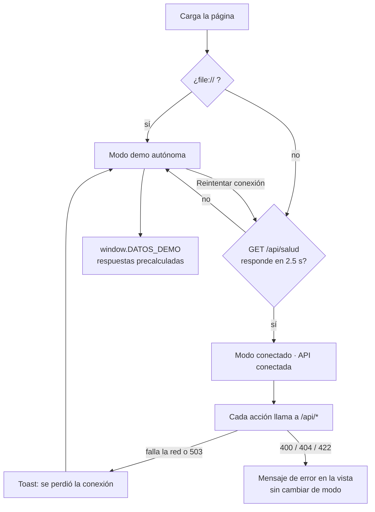

# 05 · Interfaz web (Frontend) y experiencia de uso

> **Apartado 5 · Orden 2.2** de la Tabla de Medios y Fines.
> Estado: ✅ implementado y probado en navegador (Chromium) en tres modos: con servidor, sin servidor (`file://`) y en celular (390 px).

> ⚠️ **Todo lo que muestra la interfaz son datos SIMULADOS.** La barra superior lo dice en todo momento con el distintivo ámbar **⚠️ Entorno de Validación: Datos Simulados**.

## 1. Objetivo

Dar al personal de cocina una herramienta que se entienda **en segundos**, en los cuatro momentos del día en que se decide la merma: comprar, rescatar, avisar y rendir cuentas. También debe funcionar en la demo pase lo que pase: con servidor, sin servidor o si el servidor se cae a la mitad.

## 2. Medios utilizados

| Medio | Uso |
|---|---|
| HTML5 + Vanilla JS | Sin frameworks ni compilación: se abre tal cual. |
| Tailwind CSS 3.4.17 (CDN) | Estilos utilitarios; diseño responsivo. |
| Chart.js 4.4.1 (CDN) | Gráfica de importancia de variables y comparativa semanal. |
| Lucide 0.344.0 (CDN) | Iconos. |
| `frontend/datos_demo.js` | Respuestas precalculadas para el modo demo autónoma (≈ 110 KB). |
| `scripts/exportar_datos_demo.py` | Genera `datos_demo.js` llamando al backend y al modelo reales. |

Archivos: `frontend/index.html` (estructura de las 4 vistas) y `frontend/app.js` (conexión, respaldo y lógica de cada vista).

## 3. Cómo abrirlo

```bash
python backend/main.py          # → http://localhost:8000   (modo conectado)
```

O con doble clic en `frontend/index.html` (modo demo autónoma, sin instalar nada). En ambos casos se necesita internet solo para cargar Tailwind, Chart.js y Lucide desde sus CDN.

Si se regeneran los datos o se reentrena el modelo, actualizar el respaldo:

```bash
python scripts/exportar_datos_demo.py
```

## 4. Resiliencia dual: conectado + demo autónoma



| Acción | Modo conectado | Modo demo autónoma |
|---|---|---|
| Catálogo de insumos y platillos | `GET /api/catalogo` | Copia exportada del catálogo. |
| Predicción (Vista 1) | `POST /api/predecir` | Predicción del **mismo Random Forest** precalculada para las 112 combinaciones de contexto (7 días × quincena × lluvia × evento × vacaciones); el margen y la merma evitada se calculan en JS con las mismas fórmulas del backend. |
| Inventario (Vista 2) | `GET /api/inventario` | Inventario exportado (horas restantes al momento de exportar). |
| Optimizar menú (Vista 2) | `POST /api/optimizar-menu` | Promociones exportadas de las reglas del backend. |
| Proyección y ficha (Vista 3) | `POST /api/alerta-excedente` | Mismas fórmulas portadas a JS con las constantes exportadas. |
| Enviar aviso (Vista 3) | `POST /api/alerta-excedente/{id}/enviar` | Solo confirmación local. |
| Auditoría (Vista 4) | `GET /api/auditoria` | Backtest exportado de los 46 insumos. |

**Verificado:** con servidor y sin servidor la interfaz muestra exactamente las mismas cifras para los mismos controles (por ejemplo, viernes de quincena con lluvia: 186 clientes y 15.0 kg de pollo con margen 2 %).

Reglas de la capa de conexión (`api()` y `conRespaldo()` en `app.js`):
- **Falla de red o 503** (servidor apagado o sin datos): cambia a modo demo y avisa con un toast.
- **400, 404 o 422** (entrada inválida): **no** cambia de modo; muestra el mensaje del servidor en la vista.
- El indicador de la barra superior dice siempre de dónde vienen los datos: **API conectada** (verde) o **Modo demo autónoma** (ámbar, con banner y botón "Reintentar conexión").

## 5. Las 4 vistas

### Vista 1 · Planeador de compras (ML)

- **Controles:**
  - insumo (los 46, agrupados por categoría);
  - margen de seguridad (0 % a 25 %);
  - día a planear;
  - 4 casillas de contexto: quincena, lluvia, evento cercano y vacaciones.
- **Escenario global** (barra superior): llena día y contexto de una vez.
  - Viernes de Quincena + Lluvia: viernes, quincena y lluvia.
  - Martes Regular: martes sin contexto.
  - Lunes en Vacaciones (baja afluencia): lunes con vacaciones.

  Si el usuario cambia algo a mano, el selector muestra "Personalizado".
- **4 tarjetas KPI**, que se recalculan al mover cualquier control:
  - Clientes estimados.
  - Compra sugerida, con su fórmula visible.
  - Costo estimado, comparado con la compra habitual.
  - Merma evitada, en unidades y $MXN.
- **Banner de desabasto** si el margen es menor a 4 %.
- **Margen recomendado** del insumo, con un botón "Usar".
- **Gráfica de importancia de variables:** valores reales del modelo, no ilustrativos.

### Vista 2 · Rescate rentable en menú (Gemini)

- **Tabla de inventario:** muestra primero lo que está por caducar (crítico y precaución) con semáforo de color y texto; "Ver todo" muestra los 47 lotes.
- **Botón ✨ Optimizar Menú con Gemini**, con indicador de carga.
- **Distintivo de modo:** *Generado con Gemini* o *Reglas locales (fallback)*, con el motivo.
- **Tarjetas por platillo existente:**
  - descuento, precio normal → oferta y costo por porción;
  - meta de porciones e insumos que rescata;
  - barras comparativas: **pérdida si se tira** contra **margen recuperado**.
- **Vista previa del menú QR** en un marco de celular, con el texto promocional.

### Vista 3 · Alerta temprana de excedentes

- **Controles:** slider de hora (12:00 PM a 7:00 PM, cada 30 min), ritmo de ventas (lento −30 %, normal, rápido +15 %), platillo y porciones preparadas (vacío = automático).
- **Avance de ventas:** barra y tres cifras (preparadas, venta al cierre, sobrante).
- **Estados:**
  - alerta preventiva naranja si sobran 3 porciones o más;
  - aviso de agotamiento si se acabaría antes del cierre;
  - verde si todo está en tolerancia.
- **📢 Generar Ficha de Rescate Temprano:** alimento y kg, ventana de recolección, nota de inocuidad, destinatario y mensaje listo para copiar.
- **Enviar aviso:** toast verde que aclara que **el envío es SIMULADO**.

### Vista 4 · Auditoría y backtesting

- **4 KPIs:**
  - reducción relativa de merma (%);
  - merma evitada en kg;
  - merma evitada en $MXN;
  - demanda no cubierta, comparada con la compra tradicional.
- **Gráfica diaria** de los últimos 7 días cerrados: barras de compra tradicional y compra sugerida, línea de demanda real. Se puede cambiar el insumo.
- **Acordeón "Fuentes, Supuestos y Metodología":**
  - declaración de datos SIMULADOS;
  - estado real de los precios (SIMULADOS provisionales; fuente prevista PROFECO *Quién es Quién en los Precios*);
  - contexto FAO/PNUMA;
  - metodología del backtest sin fuga de datos.

## 6. Decisiones de diseño: baja fricción operativa

| Decisión | Por qué |
|---|---|
| Una pestaña por momento del día, numeradas 1 → 4 | El orden coincide con la jornada: comprar, rescatar, avisar, rendir cuentas. |
| Escenario global en la barra superior | Un clic deja listo un día típico; ideal para la demo y para el encargado. |
| Recalcular al mover el control, sin botón "Calcular" | Menos clics; el efecto del margen se ve al instante. |
| Fórmula visible bajo cada número | El encargado entiende y confía en lo que le sugieren. |
| Margen recomendado con botón "Usar" | La decisión segura queda a un clic, pero sigue siendo del encargado. |
| Inventario filtrado a lo urgente por defecto | Lo que hay que atender primero, sin ruido. |
| Semáforo con color **y** texto (Crítico, Precaución, Óptimo) | Legible para personas con daltonismo y en pantallas de mala calidad. |
| Porciones preparadas "Automático" | Funciona sin capturar nada; se puede corregir si se conoce el dato. |
| Mensaje de la ficha seleccionable | Se copia y pega en WhatsApp o correo sin reescribir. |
| Responsivo (probado en 390 px) | El encargado lo usa desde el celular en el almacén. |
| Enlaces directos por vista (`#rescate`, `#auditoria`) | Para presentar o compartir una vista concreta. |
| Foco visible, `aria-live` en resultados y `prefers-reduced-motion` | Uso con teclado y lector de pantalla, sin animaciones para quien no las quiere. |

## 7. Decisiones de diseño: transparencia de datos

| Decisión | Por qué |
|---|---|
| Distintivo ámbar permanente **Datos Simulados** | Regla de la rúbrica; nunca desaparece al hacer scroll (barra fija). |
| Indicador **API conectada / Modo demo autónoma** | El juez sabe si ve cálculos en vivo o respuestas precalculadas. |
| Fuente bajo la gráfica del modelo ("API · Random Forest en vivo" o "Demo · predicción precalculada") | Cada cifra dice de dónde viene. |
| Distintivo **Gemini / Reglas locales (fallback)** con motivo | No se presenta como IA lo que calcularon reglas. |
| "Envío SIMULADO" en el botón y en el toast | No se afirma que se contactó a alguien. |
| Precios declarados como SIMULADOS provisionales | No se atribuyen a PROFECO cifras que aún no se consultaron. |
| Restaurante "Cafetería La Esquina" marcado como ficticio | No se confunde con un negocio real. |
| Importancias reales del modelo (día de la semana ≈ 93 %) | El prototipo `prueba1/` usaba pesos ilustrativos; aquí se muestran los verdaderos aunque sean menos vistosos. |
| Textos de Gemini insertados como texto, no como HTML (`esc()`) | Un texto generado no puede inyectar código en la página. |

## 8. Evidencia: SIMULADO vs. REAL

| Elemento en pantalla | Origen |
|---|---|
| Clientes, consumo, inventario, ventas, precios, recetas | **SIMULADO** |
| Predicciones e importancia de variables | Modelo real entrenado con datos **SIMULADOS** |
| Promociones y fichas | Gemini validado o reglas locales sobre datos **SIMULADOS** |
| Envío del aviso al comedor | **SIMULADO** |
| Restaurante y menú QR | Ficticios |

## 9. Cómo verificar que funciona

1. **Modo conectado:** `python backend/main.py`, abrir <http://localhost:8000>. La barra dice "API conectada".
2. **Modo demo:** doble clic en `frontend/index.html`. Aparece "Modo demo autónoma" y el banner ámbar; todas las vistas funcionan.
3. **Caída a mitad de sesión:** con la página abierta, detener el servidor y pulsar "Optimizar Menú". Aparece el toast "Se perdió la conexión…" y la vista sigue funcionando.
4. **Vista 1:** margen en 2 % → banner de desabasto; "Usar" margen recomendado → el banner desaparece.
5. **Vista 3:** ritmo "Ventas Lentas" a las 3:00 PM → alerta naranja → "Generar Ficha" → "Enviar" → toast verde.
6. **Consola del navegador** (F12) sin errores.
7. **Sintaxis:** `node --check frontend/app.js`.

Pruebas realizadas con Chromium (Playwright) el 2026-11-26: modo conectado a 1440 px, modo `file://` a 1440 px y modo conectado a 390 px. Las tres recorrieron las 4 vistas sin errores en consola y sin desplazamiento horizontal. También se probó la caída del servidor a mitad de sesión.

## 10. Guion de la demo en vivo (8 minutos)

Preparación (antes de entrar):
- `python backend/main.py` encendido y <http://localhost:8000> abierto. Refresca las caducidades del inventario si los datos son de otro día.
- `frontend/index.html` abierto en otra pestaña, como respaldo.
- Escenario en "Martes Regular".

| Min | Vista | Qué hacer | Qué decir |
|---|---|---|---|
| 0:00–0:45 | Barra superior | Señalar el distintivo ámbar y "API conectada". | "Un restaurante de plaza compra perecederos a ojo: o tira comida o se queda sin platillos. ZeroMerma decide en 4 momentos del día. Todo lo que verán son datos SIMULADOS y lo marcamos siempre." |
| 0:45–2:30 | 1 · Planeador | Pechuga de pollo, martes. Cambiar el escenario a **Viernes de Quincena + Lluvia**: los clientes suben de ~116 a 186. | "El Random Forest predice el consumo de 46 insumos con el día, la quincena, la lluvia, los eventos y las vacaciones. Compra sugerida = demanda × (1 + margen)." |
| | | Bajar el margen a **2 %**: aparece el banner rojo. Pulsar **Usar** el margen recomendado. | "Si el encargado recorta demasiado, avisamos del desabasto. El margen recomendado sale de los errores reales del modelo en días que no había visto: cubre 9 de cada 10 días." |
| | | Señalar la gráfica de importancia. | "Es honesta: el día de la semana explica el 93 %. No la maquillamos." |
| 2:30–4:15 | 2 · Rescate | Mostrar los 4 críticos (pollo, bolillo, crema, carne molida). Pulsar **✨ Optimizar Menú**. | "Cruzamos lo que caduca en 24 h con el recetario. Solo proponemos platillos que ya existen y nunca por debajo de 1.5 × su costo." |
| | | Señalar el distintivo de modo y una tarjeta: pérdida contra margen. | "Si se tira, se pierden $458 en enchiladas; con la promoción recuperamos $631. Gemini redacta el texto, pero las cuentas las hace y valida nuestro backend." |
| | | Señalar el menú QR. | "Así lo ve el comensal." |
| 4:15–5:45 | 3 · Alerta | Ritmo **Ventas Lentas**, hora 3:00 PM: alerta naranja. | "A media jornada proyectamos el cierre. Hoy sobrarán 4 porciones." |
| | | **Generar Ficha** → **Enviar aviso**. | "La ficha da una ventana de 4:00 a 6:00 PM, que termina 2 h antes del cierre para que el comedor alcance a repartir, y las recomendaciones de inocuidad. El envío en el prototipo es simulado; el siguiente paso es WhatsApp." |
| | | Mover la hora a 5:30 PM. | "Ya no da tiempo para una recolección segura y el sistema lo dice. Por eso la alerta es temprana." |
| 5:45–7:15 | 4 · Auditoría | Señalar los KPIs. Abrir el acordeón. | "Máquina del tiempo: reentrenamos el modelo sin la última semana y comparamos. −77 % de merma y 95 kg evitados, con menos demanda sin cubrir que la compra tradicional. Precios simulados; las fuentes y la metodología están aquí." |
| 7:15–8:00 | Respaldo | Cambiar a la pestaña de `index.html` abierta con doble clic. | "Si el servidor falla, la página no se rompe: entra en modo demo con respuestas precalculadas del mismo modelo, y lo dice arriba." |

> Las cifras del guion son de la corrida del 2026-11-26. Si se regeneran los datos otro día, cambian un poco: léanlas de la pantalla.

## 11. Preguntas probables de los jueces

**¿Por qué no React o Vue?**
Sin compilación ni `node_modules`: cualquier juez lo abre con doble clic, y cinco personas lo pueden leer en un sprint de 24 h.

**¿El modo demo no es "trampa"?**
No: está etiquetado en pantalla, y sus números salen del mismo backend y modelo (`scripts/exportar_datos_demo.py`). Lo único que no hace es recalcular en vivo el inventario y las promociones.

**¿Qué pasa si no hay internet?**
Las librerías vienen de CDN, así que sin internet la página pierde estilos y gráficas. Para la demo se recomienda tener conexión o abrir la página una vez antes, para que el navegador las guarde en caché.
